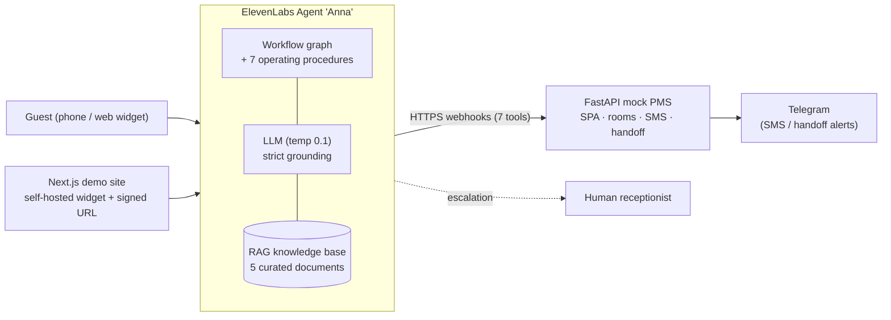

# Anna — AI Voice Receptionist for a Spa & Wellness Hotel

**A deployment case study: designing, integrating and operating a production-style voice agent on [ElevenLabs Conversational AI](https://elevenlabs.io/conversational-ai) for a health-resort hotel whose guests are mostly seniors (60+).**

> Independent portfolio project. The hotel ("Bukowy Dwór", Krynica-Zdrój, Poland) is a realistic scenario; all prices, schedules, guests and bookings are synthetic. Not affiliated with ElevenLabs or any real hotel.

| | |
|---|---|
| **Role simulated** | Solution architect / forward-deployed engineer: discovery → design → build → integrate → harden → hand over |
| **Client problem** | Front desk is overloaded with repetitive calls (SPA bookings, room availability, diets, directions); calls are lost out of hours; guests are older, speak slowly and distrust "robots" |
| **Solution** | Voice + web agent "Anna" that books SPA treatments, checks rooms, answers from a curated knowledge base, follows operating procedures, and **hands off to a human** whenever a question is clinical or outside its knowledge |
| **Stack** | ElevenLabs Agents (workflow + procedures + RAG + 7 server tools) · FastAPI mock PMS · Next.js 16 / React 19 demo site · Cloudflare Tunnel · Podman · Telegram notifications |
| **Languages** | Polish and English (the agent detects the guest's language and keeps it) |

---

## Why this project exists

Most voice-AI demos stop at "it talks". Real deployments fail on everything around the model: unreliable integrations, hallucinated facts, unsafe edge cases, unclear ROI, and no plan for the day after go-live. This repository documents the whole path for one concrete vertical, including the failures and how they were diagnosed:

1. **Understand the business** – who calls, why, what a missed call costs, what is *unsafe* to automate → [`docs/business-case.md`](docs/business-case.md), [`docs/discovery-questions.md`](docs/discovery-questions.md)
2. **Design for the user** – seniors need slow, warm, patient speech and zero jargon → [`docs/ux-design.md`](docs/ux-design.md)
3. **Design for safety** – strict grounding, clinical-question handoff, deterministic tools → [`docs/design-rationale.md`](docs/design-rationale.md)
4. **Integrate** – webhooks into a (mock) PMS, SMS confirmations, human handoff → [`docs/architecture.md`](docs/architecture.md)
5. **Operate** – observability, outage diagnosis, rollout, security/GDPR, cost → [`docs/deployment-playbook.md`](docs/deployment-playbook.md), [`docs/lessons-learned.md`](docs/lessons-learned.md)

## Architecture at a glance



Full diagrams (sequence, multi-hotel, security): [`docs/architecture.md`](docs/architecture.md) and [`docs/architecture-diagrams.md`](docs/architecture-diagrams.md).

### Agent tools

| Tool | Purpose | Production counterpart |
|---|---|---|
| `check_spa_availability` | Free slots for a treatment on a given day | PMS / SPA scheduling API |
| `book_spa_appointment` | Create a booking | PMS booking endpoint |
| `cancel_spa_appointment` / `reschedule_spa_appointment` | Change an existing booking (policy-aware) | PMS booking endpoint |
| `check_room_availability` | Availability + total price for a stay | PMS inventory & rates |
| `send_sms_summary` | Confirmation message to the guest | Twilio / SMSAPI |
| `transfer_to_simulated_handoff` | Escalate to a human with context | SIP `transfer_to_number` |

> The webhook contract is documented in [`mock_backend/README.md`](mock_backend/README.md) and served as OpenAPI at `/openapi.json` by the running backend.

## Key design decisions

| Decision | Why |
|---|---|
| **Hard rule: no information in KB ⇒ hand off** | A wrong price is a sales problem; a wrong contraindication is a liability. The agent never improvises clinical or medical answers. |
| **Low temperature (0.1) + grounding rules** | Determinism over charm for facts, prices and policies. |
| **Expressive voice model, slowed to 0.85×, patient turn-taking** | For 70+ guests, warmth and pacing drive trust more than the ~200 ms saved by a "flash" model. |
| **Critical KB files injected into the prompt, the rest via RAG** | Pricing and policy must never be "missed" by retrieval; long-tail content can be retrieved. |
| **Procedures for multi-step policies** (cancellation, deposit refund, early/late check-in, dietary needs, transfers, complaints) | Policies are encoded as auditable SOPs instead of growing one giant prompt. |
| **Signed URLs, server-side key** | The ElevenLabs API key never reaches the browser. |
| **Self-hosted widget script** | A third-party CDN being blocked (ad-blockers, corporate proxies) silently broke the widget during testing — see lessons learned. |
| **Mock PMS behind a clean HTTP contract** | The agent is integration-ready: replacing the mock with Opera/Mews/Protel is an adapter change, not an agent redesign. |

Rationale and trade-offs in detail: [`docs/design-rationale.md`](docs/design-rationale.md) · Audit of the live agent and its findings: [`docs/agent-audit.md`](docs/agent-audit.md).

## Repository map

```
agent/                 Everything that is deployed to ElevenLabs
  system_prompt.md       Persona, guardrails, escalation rules (Polish: the guests' language)
  knowledge_base/        5 curated RAG documents (Polish)
  workflow/              Workflow graph (JSON) and 7 operating procedures
  deploy_agent.py        Idempotent REST deployment of KB + settings (--dry-run supported)
mock_backend/          FastAPI mock PMS (webhook targets), tunnel + container scripts
frontend/              Next.js demo hotel website with the embedded agent
docs/                  Business case, architecture, design rationale, playbook, SOPs, audit
presentation/          Client-facing case-study deck (PPTX + HTML) and generator
```

## Run it locally

Prerequisites: Python 3.11+, Node 20+ with pnpm, optional Podman, an ElevenLabs account (the agent itself is not included — see [`agent/`](agent/) to recreate it).

**1. Mock PMS**
```bash
cd mock_backend
python -m venv .venv && source .venv/bin/activate
pip install -r requirements.txt
uvicorn main:app --port 8011
# Swagger UI: http://localhost:8011/docs
```

**2. Smoke-test a tool**
```bash
curl -X POST http://localhost:8011/check_room_availability \
  -H "Content-Type: application/json" \
  -d '{"room_type":"dwuosobowy","check_in":"2026-08-24","check_out":"2026-08-26"}'
```

**3. Demo website**
```bash
cd frontend
cp .env.example .env.local   # add ELEVENLABS_API_KEY
pnpm install && pnpm dev     # http://localhost:3030
```

**4. Expose the backend to the agent (demo mode)**
```bash
cd mock_backend/tunnel
./podman_start.sh            # container + Cloudflare quick tunnel + webhook re-pointing
./podman_stop.sh
```
The script restarts the quick tunnel and re-points all agent webhooks to the new URL, which makes the demo resilient to restarts. For anything beyond a demo, use a named tunnel or a real deployment (see the playbook).

**5. Deploy the knowledge base to the agent**
```bash
export ELEVENLABS_API_KEY=...
python agent/deploy_agent.py --dry-run   # review
python agent/deploy_agent.py
```

## What this PoC deliberately does **not** do

Honest scope, because production readiness is a different project:

- No live telephony: the agent is reachable through the web widget; handoff is simulated (production: SIP `transfer_to_number` from the hotel PBX).
- Ephemeral quick-tunnel URL; production needs a stable HTTPS endpoint behind auth.
- Mock PMS with synthetic data; no real PMS integration, no authentication on webhooks.
- No automated evaluation suite yet; testing was scripted manual conversations.

The path from here to production (security, GDPR, evaluation, monitoring, rollout, cost) is spelled out in [`docs/deployment-playbook.md`](docs/deployment-playbook.md).

## Documentation index

| Document | Audience | Content |
|---|---|---|
| [`business-case.md`](docs/business-case.md) | Executives | Problem, value drivers, KPIs, illustrative ROI model |
| [`deployment-playbook.md`](docs/deployment-playbook.md) | Delivery team | Phased rollout, go-live checklist, security & GDPR, risks, production roadmap |
| [`architecture.md`](docs/architecture.md) | Architects | Layers, protocols, integration patterns |
| [`design-rationale.md`](docs/design-rationale.md) | Stakeholders | Why it is built this way; answers to hard questions |
| [`discovery-questions.md`](docs/discovery-questions.md) | Solution team | Client discovery workshop question bank |
| [`ux-design.md`](docs/ux-design.md) | Design / product | Senior-friendly conversation and widget UX |
| [`agent-workflows-and-procedures.md`](docs/agent-workflows-and-procedures.md), [`agent-workflow.md`](docs/agent-workflow.md), [`operating-procedures.md`](docs/operating-procedures.md) | Builders | Workflow graph and SOPs |
| [`functional-specification.md`](docs/functional-specification.md), [`implementation-plan.md`](docs/implementation-plan.md) | Delivery | Functional spec and original plan |
| [`agent-audit.md`](docs/agent-audit.md) | Reviewers | Audit of the live agent and fixes |
| [`demo-script.md`](docs/demo-script.md) | Presenters | Three demo paths with fallbacks |
| [`lessons-learned.md`](docs/lessons-learned.md) | Everyone | Failures hit in practice and what changed |

## License

[MIT](LICENSE) — the knowledge base and hotel content are fictional sample data.
