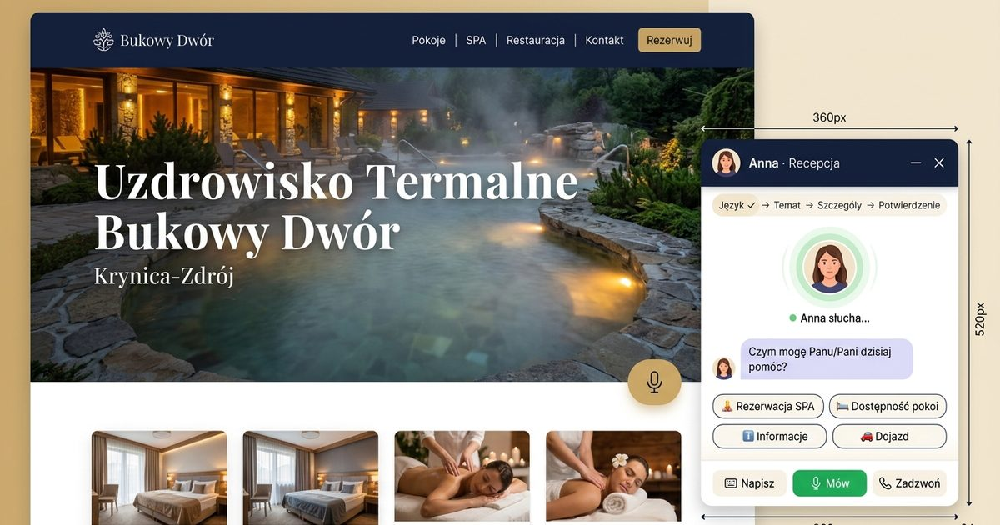
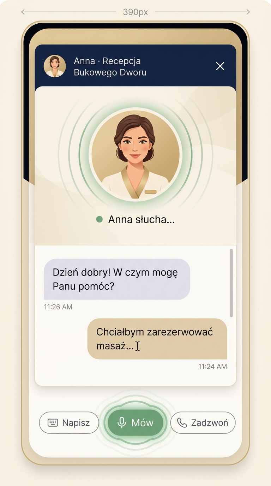
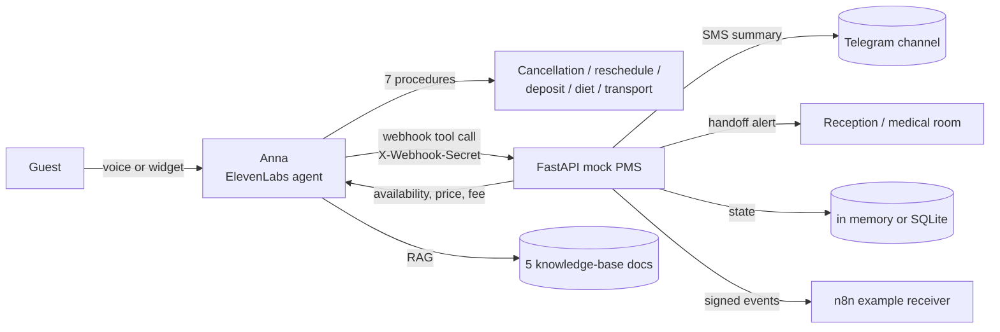

# Anna — AI Voice Receptionist for a Thermal Spa Resort

[](https://github.com/kpulka/anna-voice-agent/actions/workflows/ci.yml)
[](LICENSE)

> **TL;DR**
> - **What it is:** a portfolio case study of an end-to-end voice-agent deployment on **ElevenLabs Conversational AI**, for a fictional thermal spa resort. Anna is a Polish/English agent that books treatments, checks rooms, cancels and reschedules, and hands over to staff.
> - **What is really running:** the agent on the ElevenLabs platform (7 published procedures, 7 webhook tools, a 5-document knowledge base); a FastAPI backend with webhook authentication, JSON logs, metrics, idempotent bookings and an optional SQLite store; a Next.js site with a self-hosted widget; CI with tests, types, lint, drift gates, a container health check and security scans.
> - **What is not there yet:** telephony (the agent runs on the web widget only; handoff is simulated), a managed production deployment (the demo runs from a laptop behind a quick tunnel), and published results of live evaluation runs.

> **Reviewing this in 5 minutes without cloning?** Read in this order:
> 1. [`docs/fde-fit.md`](docs/fde-fit.md): what exists, where, and how complete it is (honest status per capability).
> 2. [`docs/lessons-learned.md`](docs/lessons-learned.md) and [`docs/postmortems/`](docs/postmortems/): production incidents and their fixes.
> 3. [`docs/PRODUCT_FEEDBACK.md`](docs/PRODUCT_FEEDBACK.md): prioritised feedback for the platform vendor.
> 4. [`mock_backend/events.py`](mock_backend/events.py) and [`mock_backend/routers/security.py`](mock_backend/routers/security.py): signed events and webhook authentication, with tests in [`mock_backend/tests/`](mock_backend/tests/).
>
> The company, guests and phone numbers are fictional; no personal data is processed (see [`NOTICE.md`](NOTICE.md)).

**Case-study deck (online):** [kpulka.github.io/anna-voice-agent](https://kpulka.github.io/anna-voice-agent/): 14 slides, PL and EN, opens in the browser.
Editable `PPTX` files are in [`presentation/`](presentation/) and were attached to [release v1.0.1](https://github.com/kpulka/anna-voice-agent/releases/tag/v1.0.1).





---

## What a Forward Deployed Engineer does here

| Responsibility | Where it is | Status |
|---|---|---|
| Requirements, scope and "never automate" list | [`docs/business-case.md`](docs/business-case.md), [`agent/_template/`](agent/_template/) | Implemented |
| Agent prompt, procedures, guardrails | [`agent/`](agent/), simulated scenarios in [`mock_backend/tunnel/`](mock_backend/tunnel/) | Partial |
| Tool contract and webhook authentication | [`mock_backend/schemas.py`](mock_backend/schemas.py), [`mock_backend/routers/security.py`](mock_backend/routers/security.py) | Implemented |
| Observability and debugging in production | [`mock_backend/logs.py`](mock_backend/logs.py), [`mock_backend/metrics.py`](mock_backend/metrics.py) | Implemented |
| Persistence (SQL) | [`mock_backend/sqlite_store.py`](mock_backend/sqlite_store.py), enabled by `ANNA_DB_PATH`; migrations and restart tests | Implemented |
| Integrations (signed events, n8n) | [`mock_backend/events.py`](mock_backend/events.py), [`integrations/n8n/`](integrations/n8n/) | Partial |
| Deployment | [`mock_backend/Dockerfile`](mock_backend/Dockerfile) built in CI; [`fly.toml`](mock_backend/fly.toml) is config only | Design only |
| Telephony | none: web widget only; the plan is in [`docs/telephony.md`](docs/telephony.md) | Design only |
| Privacy (GDPR) | [`docs/gdpr/`](docs/gdpr/) drafts, demo privacy page in the site | Partial |
| Product feedback | [`docs/PRODUCT_FEEDBACK.md`](docs/PRODUCT_FEEDBACK.md) | Implemented |
| Second client from the template | [`agent/verticals/dental_clinic/`](agent/verticals/dental_clinic/) (fictional, not run live) | Partial |
| Playbooks, incident write-ups | [`docs/deployment-playbook.md`](docs/deployment-playbook.md), [`docs/lessons-learned.md`](docs/lessons-learned.md) | Implemented |

The full mapping, with the path behind each claim and its status, is in **[docs/fde-fit.md](docs/fde-fit.md)**.

---

## Architecture



The website calls `/api/anna/signed-url`, which returns a short-lived signed URL, so the ElevenLabs API key never
reaches the browser.

## Quick start

```bash
# 1. Backend + tests (Python 3.12, no network and no credentials needed)
cd mock_backend
pip install -r requirements.txt -r requirements-dev.txt
python -m pytest -q
uvicorn main:app --port 8011  # http://localhost:8011/docs

# 2. Website
cd ../frontend
cp .env.example .env.local    # then add ELEVENLABS_API_KEY=sk_...
pnpm install && pnpm dev      # http://localhost:3000
```

The public demo path (backend + tunnel + tool re-pointing) needs `podman` and `cloudflared`:

```bash
cd mock_backend/tunnel
./podman_start.sh   # builds the image if missing, starts the backend, opens the tunnel, re-points the 7 tools
./podman_stop.sh
```

The tunnel scripts refuse to open a public tunnel while `ANNA_WEBHOOK_SECRET` is empty. Configuration variables are
listed, without values, in each `.env.example`. `.env` and `.env.local` are gitignored.

## The tool contract

An agent is only as good as the tools it can call and the answers it can trust. Every endpoint returns **200 with a
machine-readable message** for business rejections (past date, taken slot, unknown service, ambiguous service name)
and **422 only for malformed input**. A voice agent recovers from `{"success": false, "message": "…"}`; it does not
recover from a transport error in the middle of a sentence.

| Tool | Notable behaviour |
|---|---|
| `check_spa_availability` | returns `price_pln` and `duration_min`; returns `ambiguous: [...]` when "massage" matches more than one treatment, instead of guessing |
| `book_spa_appointment` | consumes the slot; with an `idempotency_key`, a retried request returns the existing booking instead of creating a second one |
| `cancel_spa_appointment` | **>2 h before = free, <2 h = 50 %, medical release = free**, computed from `appointment_datetime`; an unknown reservation returns `success:false` |
| `reschedule_spa_appointment` | releases the old slot, takes the new one, returns a new `SPA-XXXX` |
| `check_room_availability` | per-night pricing from `mock_backend/data/rooms.json`; refuses past dates |
| `send_sms_summary` | prints the SMS for the live demo and mirrors it to Telegram when configured |
| `transfer_to_simulated_handoff` | alerts reception or the medical room; simulated, because there is no telephony |

The cancellation fee is a documented business rule, so it lives in code with tests, not in the model's reasoning.

## Engineering decisions

- **A mock PMS that says no.** It reproduces the awkward parts (no availability, a taken slot, an ambiguous treatment name), which makes it a better test surface than a stub that always answers yes.
- **Procedures, not one prompt.** Cancellation fees, deposits and medical contraindications are regulated. Seven explicit procedures pin what the agent collects, in what order, and when it escalates.
- **Ephemeral tunnels are a state problem.** `trycloudflare` issues a new URL on every start. The start scripts resolve it, pin the host, and re-point all seven tools by name through one shared script.
- **Drift gates, because seams are where demos die.** `tsc --noEmit` is part of the build, PL/EN dictionaries must have the same keys, and the hotel data on the site is generated from the backend and checked in CI, so the price a guest reads cannot differ from the price Anna quotes.

## Documentation

- [docs/INDEX.md](docs/INDEX.md): the entry point; says which document is canonical for which topic.
- [docs/repo-guide.md](docs/repo-guide.md): repository map, quality gates, known limitations.
- [docs/fde-fit.md](docs/fde-fit.md): responsibilities mapped to artifacts, with statuses.
- [docs/business-case.md](docs/business-case.md), [docs/deployment-playbook.md](docs/deployment-playbook.md), [docs/lessons-learned.md](docs/lessons-learned.md): for readers who want the reasoning behind the design.
- Polish originals of the architecture and procedures: [docs/pl/](docs/pl/).

## Status

**Built and tested in this repository**

- Webhook authentication on the tool endpoints: shared secret, or per-request HMAC with a timestamp; the backend refuses to start without a secret when `ANNA_ENV=prod`.
- Request IDs, JSON logs (`ANNA_LOG_FORMAT=json`) that include conversation IDs when a tool call sends one, and a `/metrics` endpoint.
- Idempotent booking.
- Agent safety rules in the prompt: call 112 first for life-threatening symptoms, contraindication screening, health data stored as a flag; 21 simulation scenarios defined and validated offline.
- SQLite store behind `ANNA_DB_PATH`, with a schema version.
- Signed outbound events and an n8n receiver example, verified offline.
- Container image built and health-checked in CI; a Fly.io configuration that is not deployed.

**Not yet**

- Telephony: no phone number is attached to the agent, and no call is transferred to a human.
- A managed production deployment and a stable public address.
- Published results of live evaluation runs (they cost ElevenLabs credits and are run on demand).
- The updated agent prompt and knowledge base (emergency escalation, balneology screening, English rule, GDPR guardrails) are in the repository and checked offline; they have not been deployed to the live agent or run against it yet.

## Scope, honesty, license

The business is fictional: *Uzdrowisko Termalne Bukowy Dwór* does not exist. The address, phone number, prices and
staff are invented, and every photograph is an AI-generated placeholder. No guest data is processed. Details are in
[NOTICE.md](NOTICE.md). The code is [MIT](LICENSE).

This is a case study of how a conversational agent is *delivered*: scoped, constrained by real procedures, wired to
systems that can say no, tested and operated. It is not a demonstration of how well the agent can chat.

---

### Po polsku w skrócie

Studium przypadku wdrożenia agenta głosowego ElevenLabs dla fikcyjnego uzdrowiska: 7 procedur operacyjnych,
7 narzędzi webhook, mock backendu PMS z regułą opłat za anulowanie (<2 h = 50 %, zwolnienie medyczne = 0 %),
uwierzytelnianie webhooków, strona Next.js PL/EN z widgetem i proxy signed-url, testy backendu i CI. Telefonii
w tym repozytorium nie ma (działa widget webowy). Dokumentacja techniczna jest w `docs/`, zacznij od
`docs/INDEX.md`. Hotel, ceny i zdjęcia są fikcyjne.
