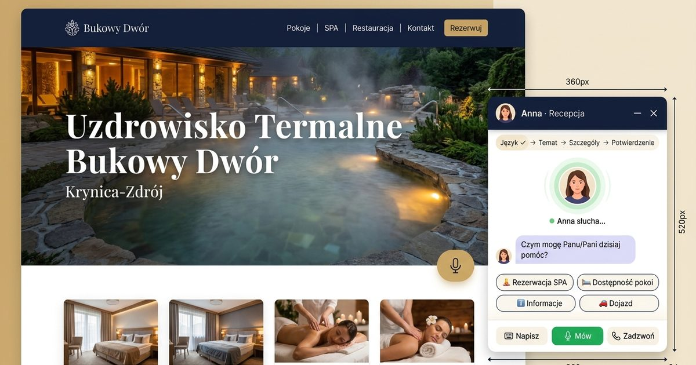
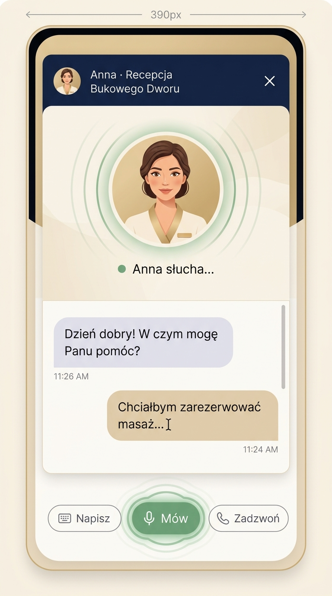
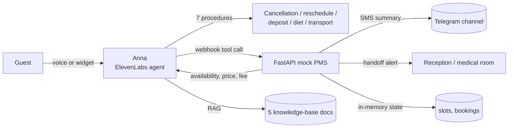

# Anna — AI Voice Receptionist for a Thermal Spa Resort

[](https://github.com/kpulka/Elevenlabs_SpaHotel_PoC/actions/workflows/ci.yml)
[](LICENSE)

A working deployment case study for **ElevenLabs Conversational AI**: a Polish/English voice agent that
handles website voice conversations and chat for a thermal spa resort (telephony-ready), books treatments, checks room availability,
cancels and reschedules appointments, sends confirmations, and hands the guest over to a human when it
should.

It is not a chatbot demo. It is the whole delivery: the agent, the operational procedures that constrain
it, the tool contract it calls, a mock PMS backend that behaves like a real one, the marketing site the
agent lives on, the CI that guards all of it, and the scripts that keep the demo alive across restarts.





---

## What is actually running

| Layer | What it is | Where |
|---|---|---|
| **Voice agent** | ElevenLabs agent `Bukowy_Dwor_Anna` — `gemini-3.5-flash-lite`, temperature 0.1, `eleven_v3_conversational` TTS, Polish + English via `user_language` | ElevenLabs workspace |
| **Behaviour** | 7 published **procedures** (cancellation, reschedule, deposit refund, early check-in / late check-out, therapeutic diet, transport, complaints) + a v3 workflow graph | `.planning/workflow/` |
| **Tools** | 7 webhook tools + `end_call`, all pointing at the mock PMS | `mock_backend/` |
| **Knowledge** | 5 knowledge-base documents with RAG on — the price and policy documents are pinned into the prompt so they are never paraphrased | `docs/baza_wiedzy_rag_bukowy_dwor*/` |
| **Backend** | FastAPI mock PMS: availability, bookings, cancellation with a real fee rule, reschedule, SMS/Telegram confirmations, handoff alerts | `mock_backend/` :8011 |
| **Website** | Next.js 16 marketing site in PL/EN with a self-hosted voice widget and a signed-url proxy so the API key never reaches the browser | `frontend/` |
| **Exposure** | Cloudflare quick tunnel + scripts that re-point every tool URL after each restart | `mock_backend/tunnel/` |



---

## Quick start

```bash
# 1. Backend + tests (Python 3.12+)
cd mock_backend
pip install -r requirements.txt -r requirements-dev.txt
python -m pytest -q           # no network, no credentials
uvicorn main:app --port 8011  # http://localhost:8011/docs

# 2. Website
cd ../frontend
cp .env.example .env.local    # then paste ELEVENLABS_API_KEY=sk_...
pnpm install && pnpm dev      # http://localhost:3000
```

The public demo path (backend + tunnel + tool re-pointing) needs `podman` and `cloudflared`:

```bash
cd mock_backend/tunnel
./podman_start.sh   # builds the image if missing, starts the backend, opens the tunnel,
                    # writes the hosts entry, re-links all 7 tools by name
./podman_stop.sh
```

No credentials live in this repo: `.env` / `.env.local` are ignored, and every `*.example` file lists the
variables it needs.

---

## The tool contract

This is the part that matters in production: an agent is only as good as the tools it can call and the
answers it can trust. Every endpoint returns **200 with a machine-readable message** for business
rejections (past date, taken slot, unknown service, ambiguous service name) and **422 only for malformed
input** — a voice agent recovers from `{"success": false, "message": "…"}` and does not recover from a
transport error mid-sentence.

| Tool | Purpose | Notable behaviour |
|---|---|---|
| `check_spa_availability` | list free slots | returns `price_pln` and `duration_min`; returns `ambiguous: [...]` when "massage" matches more than one treatment instead of silently guessing |
| `book_spa_appointment` | book a slot | consumes the slot; booking the same slot twice returns `success:false` with the remaining slots |
| `cancel_spa_appointment` | cancel | **>2 h before = free, <2 h = 50 %, medical release = free**, computed from `appointment_datetime`; an unknown reservation returns `success:false`, never a fake confirmation |
| `reschedule_spa_appointment` | move a booking | releases the old slot, takes the new one, returns a new `SPA-XXXX` |
| `check_room_availability` | price a stay | per-night pricing from `data/rooms.json`, refuses past dates, offers valid room types when the input is vague |
| `send_sms_summary` | confirmation | prints the SMS for the live demo and mirrors it to Telegram when configured |
| `transfer_to_simulated_handoff` | human handoff | alerts reception or the medical room; simulated because the widget has no telephony |

The cancellation fee is the clearest example of the design intent: it is a *documented business rule*, so
it lives in code with tests (`>2 h → 0.0`, `<2 h → 0.5`, `medical_release → 0.0`, unknown timing → 0.5 plus
an explicit `fee_rule` string), not in the model's reasoning.

---

## Engineering decisions

**Mock PMS instead of a happy-path fake.** A real deployment calls the hotel's PMS. A mock that reproduces
the awkward parts — no availability, a slot already taken, an unknown room type, "massage" matching three
treatments — is a better demo and a far better test surface than a stub that always says yes.

**Procedures, not just a prompt.** Booking a spa treatment is a regulated process: cancellation fees,
deposit rules, medical contraindications. Seven explicit procedures pin what the agent must collect, in
what order, and when to escalate, so the LLM does not improvise a refund policy.

**Signed URLs instead of an exposed API key.** The browser asks `/api/anna/signed-url`; the server
authenticates and returns a short-lived signed URL for the conversation. The key never ships to the client.

**Ephemeral tunnels are a state-machine problem, not an annoyance.** `trycloudflare` hands out a new URL
after every restart and silently breaks every webhook. The start scripts resolve the new URL, rewrite the
`hosts` entry (this network's router has no A-records), and re-point all seven tools by name through one
shared `sync_agent_tools.py` used by both the Podman and the plain-Python path.

**Type safety and drift gates, because seams are where demos die.** `tsc --noEmit` is part of the build
(no `ignoreBuildErrors`), PL/EN dictionaries are checked for key parity, and generated hotel data is
verified against the backend JSON in CI so the price a guest reads on the site cannot drift from the price
Anna quotes out loud.

---

## Quality gates

```bash
cd mock_backend && python -m pytest -q        # tool contract + business rules
cd frontend && pnpm typecheck && pnpm build   # strict TypeScript, production build
```

CI (`.github/workflows/ci.yml`) runs the same commands on every push and pull request. Several rules are
enforced by tests rather than by convention: an unknown reservation cannot be "cancelled", a slot cannot
be sold twice, a malformed date is a 422, and a business rejection is never a 5xx.

---

## Known limitations (read this before judging the demo)

- **Telephony is inactive.** The agent runs through the web widget only; handoff is simulated
  (`transfer_to_simulated_handoff`) because `transfer_to_number` needs a SIP trunk.
- **The tunnel URL is ephemeral.** The scripts repair it on every start; a stable address needs a domain
  plus a named Cloudflare tunnel.
- **State is in memory.** Restarting the backend resets bookings and slots — deliberate for a demo, not a
  database.
- **The knowledge base is a snapshot.** Prices and policies also live in the text files uploaded to
  ElevenLabs; regenerating and re-uploading them is a manual step and is called out in `docs/INDEX.md`.
- **The contact form is a demo.** It validates and shows a confirmation; it does not send e-mail.

---

## Repository map

```
mock_backend/     FastAPI mock PMS + tests + tunnel/podman scripts
  schemas.py      Pydantic request models — the agent-facing contract
  catalog.py      canonical treatment catalogue + alias resolver
  store.py        in-memory slots, bookings, blocked dates
frontend/         Next.js site + voice widget + signed-url proxy
docs/             INDEX.md → architecture, procedures, workflow, audit
  archive/        superseded prompts, specs and pre-GSD plans (kept for history)
.planning/        GSD trail: roadmap, per-phase briefs, workflow graphs, procedure ids
presentation/     interview deck (PL/EN), demo narration, screenshots
```

Start at **[docs/INDEX.md](docs/INDEX.md)** — it says which document is canonical for which topic and what
sits in the archive.

---

## Scope, honesty, license

Fictional business: *Uzdrowisko Termalne Bukowy Dwór* does not exist; the address, phone number, prices and
staff are invented, and every photograph is an AI-generated placeholder. No guest data is processed.
Details in [NOTICE.md](NOTICE.md). Code is [MIT](LICENSE).

Built as a deployment-strategy case study: the point was to show how a conversational agent is *delivered*
— scoped, constrained by real procedures, wired to systems that can say no, tested and operated — rather
than how nicely it can chat.

---

### Po polsku w skrócie

Studium przypadku wdrożenia agenta głosowego ElevenLabs dla fikcyjnego uzdrowiska: 7 procedur operacyjnych,
7 narzędzi webhook, mock backendu PMS z prawdziwą regułą opłat za anulowanie (<2 h = 50 %, zwolnienie
medyczne = 0 %), strona Next.js PL/EN z widgetem i proxy signed-url, testy backendu i CI. Dokumentacja
techniczna jest po polsku — zacznij od `docs/INDEX.md`. Hotel, ceny i zdjęcia są fikcyjne.
