# Agent Workflow Specification: ElevenLabs Agent Graph for Anna at Bukowy Dwór

> Conversation flow architecture for the Anna virtual receptionist, defined as a state graph with routing, tool calls, RAG lookups, medical guardrails and human handoff.

> Aligned with the ElevenAgents graph model: states (nodes), transition conditions (edges), tool calls and safety procedures (medical guardrails).

---

## 1. Concept and Workflow Architecture

The ElevenLabs conversation graph structures a non-linear conversation with the guest (particularly seniors aged 60+) into deterministic states. Instead of one large prompt, the agent moves through specialised nodes, each with its own micro-prompt, validation rules and assigned tools.

### Core pillars of the workflow
1. **Dynamic intent router:** rapid classification of the guest's needs (SPA, rooms, general questions, transfer).
2. **Balneological interview (medical triage):** mandatory verification of health contraindications before booking thermal and sulphur treatments.
3. **Availability and paraphrase loop:** check times in the PMS → present 2–3 options → read back a summary aloud before booking.
4. **Multi-channel confirmation:** automatic SMS / Telegram dispatch with the booking number (`SPA-XXXX` / `HOTEL-XXXX`).
5. **Native human handoff:** seamless transfer to a live receptionist or a nursing duty room in emergency situations.

---

## 2. Mermaid.js Diagram: Complete Conversation Flow Graph

The diagram below shows the full Anna workflow, including all branches, tools, the knowledge base and escalation procedures.

```mermaid
flowchart TD
    %% ==========================================
    %% STYLING & PALETTE DEFINITIONS
    %% ==========================================
    classDef startNode fill:#1B2A4A,stroke:#C9A84C,stroke-width:3px,color:#FFFFFF,font-weight:bold;
    classDef routerNode fill:#233458,stroke:#C9A84C,stroke-width:2px,color:#FFFFFF,font-weight:bold;
    classDef stateNode fill:#FDFAF5,stroke:#1B2A4A,stroke-width:2px,color:#1B2A4A;
    classDef toolNode fill:#E8DCC8,stroke:#C9A84C,stroke-width:2px,color:#1B2A4A,font-weight:bold;
    classDef guardNode fill:#FFF3CD,stroke:#856404,stroke-width:2px,color:#856404,font-weight:bold;
    classDef handoffNode fill:#F8D7DA,stroke:#721C24,stroke-width:2px,color:#721C24,font-weight:bold;
    classDef endNode fill:#7A9E7E,stroke:#1B2A4A,stroke-width:2px,color:#FFFFFF,font-weight:bold;
    classDef ragNode fill:#EBF3EB,stroke:#7A9E7E,stroke-width:2px,color:#1B2A4A;

    %% ==========================================
    %% 1. START & INITIALISATION
    %% ==========================================
    START(["Call initiation / WebRTC\n(inject variables: hotel_name, location)"]):::startNode
    GREETING["Anna's greeting:\n'Dzień dobry, z tej strony Anna, recepcjonistka Bukowego Dworu.\nW czym mogę dzisiaj pomóc?'\n(Good day, this is Anna, receptionist at Bukowy Dwór. How can I help you today?)"]:::stateNode

    START --> GREETING
    GREETING --> ROUTER{"Intent router\n(classifies the guest's speech)"}:::routerNode

    %% ==========================================
    %% 2. MAIN ROUTER BRANCHES
    %% ==========================================
    ROUTER -->|"1. Booking / SPA treatments"| SPA_INTENT["SPA and health path"]:::stateNode
    ROUTER -->|"2. Booking / rooms"| ROOM_INTENT["Rooms and stay path"]:::stateNode
    ROUTER -->|"3. Questions / directions / diets"| RAG_INTENT["Information path (RAG)"]:::ragNode
    ROUTER -->|"4. Request for a person"| HANDOFF_HUMAN["Connect me to reception"]:::handoffNode
    ROUTER -->|"5. Health risk / pain"| EMERGENCY["Emergency / medical situation"]:::handoffNode

    %% ==========================================
    %% 3. SPA & BALNEOTHERAPY SUBSYSTEM
    %% ==========================================
    subgraph SUB_SPA ["SPA AND MEDICAL TREATMENTS MODULE"]
        SPA_INTENT --> SPA_IDENTIFY["Identify treatment:\n(e.g. sulphur bath, peat, massage)"]:::stateNode
        SPA_IDENTIFY --> SPA_CHECK_GUARD{"Thermal / balneological treatment?"}:::guardNode

        %% Medical screening
        SPA_CHECK_GUARD -->|"YES (e.g. sulphur, peat)"| SPA_TRIAGE["Medical screening:\n'Czy ma Pan/Pani wskazania kardiologiczne\nlub ostre stany zapalne?'\n(Do you have any cardiac conditions or acute inflammation?)"]:::guardNode
        SPA_CHECK_GUARD -->|"NO (e.g. classic massage)"| SPA_DATE_TIME["Agree preferred date and time of day"]:::stateNode

        SPA_TRIAGE -->|"Contraindication detected"| SPA_REJECT["Explanation of medical risk\n+ recommendation to consult a doctor"]:::guardNode
        SPA_REJECT --> SPA_ALT{"Guest wants another treatment?"}:::routerNode
        SPA_ALT -->|"YES"| SPA_IDENTIFY
        SPA_ALT -->|"NO (wants a doctor)"| EMERGENCY

        SPA_TRIAGE -->|"No contraindications (safe)"| SPA_DATE_TIME

        %% Availability tool call
        SPA_DATE_TIME --> SPA_CALL_AVAIL[["TOOL: check_spa_availability\n(service_name, date)"]]:::toolNode
        SPA_CALL_AVAIL --> SPA_AVAIL_RES{"Slots available in PMS?"}:::routerNode

        SPA_AVAIL_RES -->|"No free slots"| SPA_NO_SLOTS["Offer another day or time"]:::stateNode
        SPA_NO_SLOTS --> SPA_DATE_TIME

        SPA_AVAIL_RES -->|"Times found"| SPA_PROPOSE["Offer 2–3 options:\n'Mam wolne 10:00, 14:30 i 15:00. Która odpowiada?'\n(I have 10:00, 14:30 and 15:00 free. Which one suits you?)"]:::stateNode
        SPA_PROPOSE --> SPA_COLLECT["Record choice + guest's first and last name"]:::stateNode

        %% Paraphrase and booking
        SPA_COLLECT --> SPA_PARAPHRASE["Paraphrase agreed details:\n'Podsumowując: Kąpiel siarczkowa, 27 sierpnia o 14:30 dla Pana Jana. Zgadza się?'\n(To summarise: sulphur bath, 27 August at 14:30 for Mr Jan. Is that correct?)"]:::stateNode
        SPA_PARAPHRASE --> SPA_CONFIRM_CHECK{"Guest agrees?"}:::routerNode

        SPA_CONFIRM_CHECK -->|"Correction / change"| SPA_DATE_TIME
        SPA_CONFIRM_CHECK -->|"YES, I confirm"| SPA_BOOK_EXEC[["TOOL: book_spa_appointment\n(service_name, date, time, guest_name)"]]:::toolNode

        SPA_BOOK_EXEC --> SPA_SEND_SMS[["TOOL: send_sms_summary\n(phone, summary, confirmation_id)"]]:::toolNode
        SPA_SEND_SMS --> SPA_SUCCESS["Confirmation with booking code:\n'Zarezerwowane! Numer: SPA-4821. Wysłałam potwierdzenie SMS.'\n(Booked! Number: SPA-4821. I have sent the confirmation by SMS.)"]:::stateNode
    end

    %% ==========================================
    %% 4. ROOM BOOKING SUBSYSTEM
    %% ==========================================
    subgraph SUB_ROOMS ["ROOM BOOKING MODULE"]
        ROOM_INTENT --> ROOM_PARAMS["Collect requirements:\n(check-in/out dates, number of guests, room type)"]:::stateNode
        ROOM_PARAMS --> ROOM_AVAIL_EXEC[["TOOL: check_room_availability\n(room_type, check_in, check_out)"]]:::toolNode

        ROOM_AVAIL_EXEC --> ROOM_RES{"Available for the dates?"}:::routerNode
        ROOM_RES -->|"No availability"| ROOM_NO_AVAIL["Propose another date or room"]:::stateNode
        ROOM_NO_AVAIL --> ROOM_PARAMS

        ROOM_RES -->|"Available"| ROOM_PRICE_QUOTE["Quote total price and facilities:\n(step-free access, lift, orthopaedic mattress)"]:::stateNode
        ROOM_PRICE_QUOTE --> ROOM_GUEST_DATA["Collect guest and phone details"]:::stateNode
        ROOM_GUEST_DATA --> ROOM_SMS[["TOOL: send_sms_summary\n(preliminary calculation + booking number)"]]:::toolNode
        ROOM_SMS --> ROOM_SUCCESS["Confirmation of preliminary room booking"]:::stateNode
    end

    %% ==========================================
    %% 5. KNOWLEDGE BASE (RAG) SUBSYSTEM
    %% ==========================================
    subgraph SUB_RAG ["KNOWLEDGE BASE RAG (STRICT GROUNDING)"]
        RAG_INTENT --> RAG_SEARCH["Semantic search / RAG lookup:\n• 01_general_info_and_directions.md (parking, golf cart)\n• 04_restaurant_and_diets.md (diets, meal times)\n• 05_procedures_and_policies.md (packages, health resort fee)"]:::ragNode
        RAG_SEARCH --> RAG_EVAL{"Does the information exist in the knowledge base?"}:::routerNode

        RAG_EVAL -->|"YES: precise answer"| RAG_ANSWER["Calm, factual answer to the guest"]:::ragNode
        RAG_EVAL -->|"NO: not in knowledge base"| RAG_UNKNOWN["'Nie mam tej informacji w systemie. Chętnie połączę z recepcją, aby to ustalić.'\n(I do not have that information in the system. I will gladly connect you with reception to clarify.)"]:::stateNode
        RAG_UNKNOWN --> HANDOFF_HUMAN
    end

    %% ==========================================
    %% 6. ESCALATION AND CLOSING MODULE
    %% ==========================================
    subgraph SUB_HANDOFF ["ESCALATION (HUMAN HANDOFF)"]
        EMERGENCY --> CALL_NURSE["Priority message:\n'Pani/Pana zdrowie jest najważniejsze. Natychmiast łączę z dyżurką medyczną.'\n(Your health comes first. I am connecting you to the medical duty room immediately.)"]:::handoffNode
        CALL_NURSE --> EXEC_TRANSFER_NURSE[["TOOL: transfer_to_simulated_handoff\n(department: dyzurka_medyczna)"]]:::handoffNode

        HANDOFF_HUMAN --> CALL_RECEPTION["'Oczywiście, już łączę z pracownikiem recepcji. Proszę o chwilę cierpliwości.'\n(Of course, I am connecting you to a receptionist now. Please be patient for a moment.)"]:::handoffNode
        CALL_RECEPTION --> EXEC_TRANSFER_REC[["TOOL: transfer_to_simulated_handoff\n(department: recepcja)"]]:::handoffNode
    end

    %% ==========================================
    %% 7. WRAP-UP AND CLOSING
    %% ==========================================
    SPA_SUCCESS --> WRAP_UP{"Can I help with anything else?"}:::routerNode
    ROOM_SUCCESS --> WRAP_UP
    RAG_ANSWER --> WRAP_UP

    WRAP_UP -->|"YES, another matter"| ROUTER
    WRAP_UP -->|"NO, thank you"| GOODBYE["Warm farewell:\n'Dziękuję serdecznie za rozmowę. Życzę udanego dnia i do zobaczenia w Bukowym Dworze!'\n(Thank you very much for the conversation. I wish you a pleasant day, and see you at Bukowy Dwór!)"]:::endNode

    GOODBYE --> END_SESSION(["End call"]):::endNode
```

---

## 3. Node Specification

| Node ID | Node name | Role and instructions (micro-prompt) | Available tools / outputs |
|---|---|---|---|
| **`N_START`** | Greeting & Init | Greet the guest in a warm voice (0.85x), introduce yourself as Anna, establish the purpose of the call. | `ROUTER_INTENT` |
| **`N_ROUTER`** | Intent Router | Analyse the guest's utterance. Classify into 5 thematic paths. | `SUB_SPA`, `SUB_ROOMS`, `SUB_RAG`, `HANDOFF`, `EMERGENCY` |
| **`N_SPA_TRIAGE`** | Balneology Guardrail | Mandatory health question for treatments that load the circulatory system. | Proceed to times OR medical escalation |
| **`N_SPA_AVAIL`** | PMS Schedule Check | Query the hotel system for available times on the selected day. | `check_spa_availability` |
| **`N_SPA_PARAPHRASE`** | Confirmation Gate | Read back the treatment, date, time and guest's name aloud before booking. | Consent → `book_spa_appointment` |
| **`N_SPA_SMS`** | Notification Dispatch | Send the SMS with the confirmation number immediately. | `send_sms_summary` |
| **`N_ROOM_AVAIL`** | PMS Room Engine | Verify availability of single rooms, double rooms and suites. | `check_room_availability` |
| **`N_RAG_LOOKUP`** | Knowledge Engine | Answer with strict grounding, using the 5 knowledge base files. | RAG KB files (01–05) |
| **`N_HANDOFF_MED`** | Medical Escalation | Immediately transfer the call to the nursing duty room number. | `transfer_to_simulated_handoff` (PoC; production: `transfer_to_number` to the duty room) |
| **`N_HANDOFF_REC`** | Reception Transfer | Transfer the call to a live receptionist if the guest asks, or if the information is not available. | `transfer_to_simulated_handoff` (PoC; production: `transfer_to_number` to reception) |
| **`N_END`** | End Conversation | Courteous thanks and wishes for a pleasant day. | `end_call` |

---

## 4. Additional Recommendations for Implementation in ElevenLabs Studio

### 4.1. Sub-prompts per node (stateful architecture)
Instead of maintaining 2,000 words in a single main prompt, it is advisable to assign short rules per state in the **ElevenLabs Workflows** configuration:
- In state `N_SPA_TRIAGE`, the prompt instructs the agent to focus **exclusively** on patient safety and does not allow progression without a clear answer from the guest.
- In state `N_SPA_PARAPHRASE`, the agent is strictly prohibited from calling the tool `book_spa_appointment` until the guest gives an affirmative answer ("Tak" / "Yes", "Zgadza się" / "That is correct", "Poproszę" / "Please go ahead").

### 4.2. Silence and retry policy
- **Senior silent for more than 3.0 s:** the agent says gently: *"Czy jest Pani/Pan jeszcze ze mną? Mogę powtórzyć dostępne godziny."* (*"Are you still there? I can repeat the available times."*)
- **Second failure to recognise the intent:** the agent does not repeat the question indefinitely, but proposes: *"Przepraszam, chyba słabo Panią/Pana słyszę. Czy połączyć z recepcją?"* (*"I am sorry, I think I am not hearing you well. Shall I connect you to reception?"*), followed by an automatic transfer.

### 4.3. Global interruptibility (barge-in)
- The welcome node and the presentation of times have the **Interruptible** option enabled, so that the guest can speak at any time (for example *"Wybieram czternastą trzydzieści"* (*"I choose fourteen thirty"*)). This shortens the call and makes the dialogue more natural.
