# Specyfikacja i Graf Workflow Agenta ElevenLabs — Anna (Bukowy Dwór)

> Dokumentacja architektury przepływu konwersacji (**ElevenLabs Agent Workflows**) dla Wirtualnej Recepcjonistki Anny w Uzdrowisku Termalnym „Bukowy Dwór”.
> Zgodna z oficjalnym modelem grafowym ElevenAgents: stany (węzły), warunki przejść (krawędzie), wywołania narzędzi (Tool Calling) i procedury bezpieczeństwa (Medical Guardrails).

---

## 1. Koncepcja i Architektura Workflow

Graf konwersacyjny w ElevenLabs porządkuje nieliniową rozmowę z gościem (zwłaszcza seniorami 60+) w deterministyczne stany. Zamiast jednego gigantycznego promptu, agent przechodzi przez wyspecjalizowane węzły z własnymi mikropromptami, regułami walidacji i przypisanymi narzędziami.

### Główne filary workflow:
1. **Dynamiczny Router Intencji:** Błyskawiczna klasyfikacja potrzeb gościa (SPA, Pokoje, Pytania ogólne, Transfer).
2. **Wywiad Balneologiczny (Medical Triage):** Obowiązkowa weryfikacja przeciwwskazań zdrowotnych przed zapisem na zabiegi termalne i siarczkowe.
3. **Pętla Dostępności i Parafrazowania:** Sprawdzenie terminów w PMS -> prezentacja 2-3 opcji -> głośne podsumowanie przed zapisem.
4. **Wielokanałowe Potwierdzenie:** Automatyczna wysyłka SMS/Telegram z numerem rezerwacji (`SPA-XXXX` / `HOTEL-XXXX`).
5. **Natywny Human Handoff:** Płynne przełączenie na żywą recepcję lub dyżurkę pielęgniarską w sytuacjach awaryjnych.

---

## 2. Diagram Mermaid.js — Kompletny Graf Przepływu Rozmowy

Poniższy diagram przedstawia pełny workflow agenta Anna ze wszystkimi rozwidleniami, narzędziami, bazą wiedzy oraz procedurami eskalacji.

```mermaid
flowchart TD
    %% ==========================================
    %% STYLING & PALETTE DEFINITIONS
    %% ==========================================
    classDef startNode fill:#1B2A4A,stroke:#C9A84C,stroke-width:3px,color:#FFFFFF,font-weight:bold;
    classDef routerNode fill:#233458,stroke:#C9A84C,stroke-width:2px,color:#FFFFFF,font-weight:bold;
    classDef stateNode fill:#FDFAF5,stroke:#1B2A4A,stroke-width:2px,color:#1B2A4A;
    classDef toolNode fill:#E8DCC8,stroke:#C9A84C,stroke-width:2px,color:#1B2A4A,font-weight:bold;
    classDef guardNode fill:#FFF3CD,stroke:#856404,stroke-width:2px,color:#856404,font-weight:bold;
    classDef handoffNode fill:#F8D7DA,stroke:#721C24,stroke-width:2px,color:#721C24,font-weight:bold;
    classDef endNode fill:#7A9E7E,stroke:#1B2A4A,stroke-width:2px,color:#FFFFFF,font-weight:bold;
    classDef ragNode fill:#EBF3EB,stroke:#7A9E7E,stroke-width:2px,color:#1B2A4A;

    %% ==========================================
    %% 1. START & INICJALIZACJA
    %% ==========================================
    START(["📞 Inicjacja połączenia / WebRTC\n(Wstrzyknięcie zmiennych: hotel_name, location)"]):::startNode
    GREETING["🗣️ Powitanie Anny:\n'Dzień dobry, z tej strony Anna, recepcjonistka Bukowego Dworu.\nW czym mogę dzisiaj pomóc?'"]:::stateNode
    
    START --> GREETING
    GREETING --> ROUTER{"🧠 Router Intencji\n(Klasyfikacja mowy gościa)"}:::routerNode

    %% ==========================================
    %% 2. GŁÓWNE GAŁĘZIE ROUTERA
    %% ==========================================
    ROUTER -->|"1. Rezerwacja / Zabiegi SPA"| SPA_INTENT["🧖‍♀️ Ścieżka SPA & Zdrowie"]:::stateNode
    ROUTER -->|"2. Rezerwacja / Pokoje"| ROOM_INTENT["🛏️ Ścieżka Pokoje & Pobyt"]:::stateNode
    ROUTER -->|"3. Pytania / Dojazd / Diety"| RAG_INTENT["📚 Ścieżka Informacyjna (RAG)"]:::ragNode
    ROUTER -->|"4. Prośba o człowieka"| HANDOFF_HUMAN["👤 Chcę rozmawiać z recepcją"]:::handoffNode
    ROUTER -->|"5. Zagrożenie zdrowia / Ból"| EMERGENCY["🚨 Sytuacja Awaryjna / Medyczna"]:::handoffNode

    %% ==========================================
    %% 3. SUBSYSTEM SPA & BALNEOTERAPIA
    %% ==========================================
    subgraph SUB_SPA ["🧖‍♀️ MODUŁ SPA & ZABIEGI MEDYCZNE"]
        SPA_INTENT --> SPA_IDENTIFY["Rozpoznanie zabiegu:\n(np. kąpiel siarczkowa, borowina, masaż)"]:::stateNode
        SPA_IDENTIFY --> SPA_CHECK_GUARD{"Czy zabieg termalny / balneologiczny?"}:::guardNode
        
        %% Wywiad medyczny
        SPA_CHECK_GUARD -->|"TAK (np. siarczkowa, borowina)"| SPA_TRIAGE["⚠️ Wywiad Medyczny:\n'Czy ma Pan/Pani wskazania kardiologiczne\nlub ostre stany zapalne?'"]:::guardNode
        SPA_CHECK_GUARD -->|"NIE (np. masaż klasyczny)"| SPA_DATE_TIME["Ustalenie preferowanej daty i pory dnia"]:::stateNode
        
        SPA_TRIAGE -->|"Wykryto przeciwwskazanie"| SPA_REJECT["Wyjaśnienie ryzyka medycznego\n+ Rekomendacja konsultacji lekarskiej"]:::guardNode
        SPA_REJECT --> SPA_ALT{"Gość chce inny zabieg?"}:::routerNode
        SPA_ALT -->|"TAK"| SPA_IDENTIFY
        SPA_ALT -->|"NIE (Chce lekarza)"| EMERGENCY

        SPA_TRIAGE -->|"Brak przeciwwskazań (Bezpiecznie)"| SPA_DATE_TIME
        
        %% Wywołanie narzędzia dostępności
        SPA_DATE_TIME --> SPA_CALL_AVAIL[["🔧 TOOL: check_spa_availability\n(service_name, date)"]]:::toolNode
        SPA_CALL_AVAIL --> SPA_AVAIL_RES{"Dostępne sloty w PMS?"}:::routerNode
        
        SPA_AVAIL_RES -->|"Brak wolnych miejsc"| SPA_NO_SLOTS["Zaproponowanie innego dnia lub godziny"]:::stateNode
        SPA_NO_SLOTS --> SPA_DATE_TIME

        SPA_AVAIL_RES -->|"Znaleziono godziny"| SPA_PROPOSE["Prezentacja 2-3 opcji:\n'Mam wolne 10:00, 14:30 i 15:00. Która odpowiada?'"]:::stateNode
        SPA_PROPOSE --> SPA_COLLECT["Zapisanie wyboru + Imię i Nazwisko gościa"]:::stateNode
        
        %% Parafrazowanie i Rezerwacja
        SPA_COLLECT --> SPA_PARAPHRASE["🗣️ Parafrazowanie ustaleń:\n'Podsumowując: Kąpiel siarczkowa, 27 sierpnia o 14:30 dla Pana Jana. Zgadza się?'"]:::stateNode
        SPA_PARAPHRASE --> SPA_CONFIRM_CHECK{"Zgoda gościa?"}:::routerNode
        
        SPA_CONFIRM_CHECK -->|"Poprawka / Zmiana"| SPA_DATE_TIME
        SPA_CONFIRM_CHECK -->|"TAK, potwierdzam"| SPA_BOOK_EXEC[["🔧 TOOL: book_spa_appointment\n(service_name, date, time, guest_name)"]]:::toolNode
        
        SPA_BOOK_EXEC --> SPA_SEND_SMS[["🔧 TOOL: send_sms_summary\n(phone, summary, confirmation_id)"]]:::toolNode
        SPA_SEND_SMS --> SPA_SUCCESS["🗣️ Potwierdzenie z kodem rezerwacji:\n'Zarezerwowane! Numer: SPA-4821. Wysłałam potwierdzenie SMS.'"]:::stateNode
    end

    %% ==========================================
    %% 4. SUBSYSTEM POKOJE & POBYT
    %% ==========================================
    subgraph SUB_ROOMS ["🛏️ MODUŁ REZERWACJI POKOI"]
        ROOM_INTENT --> ROOM_PARAMS["Zebranie wymagań:\n(termin check-in/out, liczba osób, typ pokoju)"]:::stateNode
        ROOM_PARAMS --> ROOM_AVAIL_EXEC[["🔧 TOOL: check_room_availability\n(room_type, check_in, check_out)"]]:::toolNode
        
        ROOM_AVAIL_EXEC --> ROOM_RES{"Dostępność w terminie?"}:::routerNode
        ROOM_RES -->|"Brak miejsc"| ROOM_NO_AVAIL["Propozycja innego terminu lub pokoju"]:::stateNode
        ROOM_NO_AVAIL --> ROOM_PARAMS

        ROOM_RES -->|"Dostępny"| ROOM_PRICE_QUOTE["Podanie ceny całkowitej i udogodnień:\n(Brak progów, winda, materac ortopedyczny)"]:::stateNode
        ROOM_PRICE_QUOTE --> ROOM_GUEST_DATA["Pobranie danych gościa i telefonu"]:::stateNode
        ROOM_GUEST_DATA --> ROOM_SMS[["🔧 TOOL: send_sms_summary\n(Wstępna kalkulacja + numer rezerwacji)"]]:::toolNode
        ROOM_SMS --> ROOM_SUCCESS["🗣️ Potwierdzenie wstępnej rezerwacji pokoju"]:::stateNode
    end

    %% ==========================================
    %% 5. SUBSYSTEM BAZA WIEDZY RAG
    %% ==========================================
    subgraph SUB_RAG ["📚 BAZA WIEDZY RAG (STRICT GROUNDING)"]
        RAG_INTENT --> RAG_SEARCH["🔍 Semantic Search / RAG Lookup:\n• 01_dojazd.md (parking, meleks)\n• 04_restauracja.md (diety, godziny posiłków)\n• 05_procedury.md (pakiety, opłata uzdrowiskowa)"]:::ragNode
        RAG_SEARCH --> RAG_EVAL{"Czy informacja istnieje w bazie?"}:::routerNode
        
        RAG_EVAL -->|"TAK — precyzyjna odpowiedź"| RAG_ANSWER["🗣️ Spokojna, rzeczowa odpowiedź gościowi"]:::ragNode
        RAG_EVAL -->|"NIE — brak w bazie"| RAG_UNKNOWN["'Nie mam tej informacji w systemie.\nChętnie połączę z recepcją, aby to ustalić.'"]:::stateNode
        RAG_UNKNOWN --> HANDOFF_HUMAN
    end

    %% ==========================================
    %% 6. MODUŁ ESKALACJI I ZAKOŃCZENIA
    %% ==========================================
    subgraph SUB_HANDOFF ["🚨 OBSŁUGA ESKALACJI (HUMAN HANDOFF)"]
        EMERGENCY --> CALL_NURSE["🗣️ Komunikat priorytetowy:\n'Pani/Pana zdrowie jest najważniejsze. Natychmiast łączę z dyżurką medyczną.'"]:::handoffNode
        CALL_NURSE --> EXEC_TRANSFER_NURSE[["🔧 TOOL: transfer_to_simulated_handoff\n(department: dyzurka_medyczna)"]]:::handoffNode

        HANDOFF_HUMAN --> CALL_RECEPTION["🗣️ Komunikat:\n'Oczywiście, już łączę z pracownikiem recepcji. Proszę o chwilę cierpliwości.'"]:::handoffNode
        CALL_RECEPTION --> EXEC_TRANSFER_REC[["🔧 TOOL: transfer_to_simulated_handoff\n(department: recepcja)"]]:::handoffNode
    end

    %% ==========================================
    %% 7. ZAMKNIĘCIE I WRAP-UP
    %% ==========================================
    SPA_SUCCESS --> WRAP_UP{"Czy mogę pomóc w czymś jeszcze?"}:::routerNode
    ROOM_SUCCESS --> WRAP_UP
    RAG_ANSWER --> WRAP_UP

    WRAP_UP -->|"TAK — inna sprawa"| ROUTER
    WRAP_UP -->|"NIE — dziękuję"| GOODBYE["🗣️ Ciepłe pożegnanie:\n'Dziękuję serdecznie za rozmowę. Życzę udanego dnia i do zobaczenia w Bukowym Dworze!'"]:::endNode
    
    GOODBYE --> END_SESSION(["🔴 Zakończenie połączenia (End Call)"]):::endNode
```

---

## 3. Szczegółowy Opis Węzłów (Nodes Specification)

| ID Węzła | Nazwa Węzła | Rola i Instrukcje (Mikroprompt) | Dostępne Narzędzia / Wyjścia |
|---|---|---|---|
| **`N_START`** | Greeting & Init | Powitanie ciepłym głosem (0.85x), przedstawienie się imieniem Anna, ustalenie celu telefonu. | `ROUTER_INTENT` |
| **`N_ROUTER`** | Intent Router | Analiza wypowiedzi gościa. Klasyfikacja do 5 ścieżek tematycznych. | `SUB_SPA`, `SUB_ROOMS`, `SUB_RAG`, `HANDOFF`, `EMERGENCY` |
| **`N_SPA_TRIAGE`** | Balneology Guardrail | Obowiązkowe pytanie o zdrowie przy zabiegach obciążających układ krążenia. | Przejście do terminów LUB eskalacja medyczna |
| **`N_SPA_AVAIL`** | PMS Schedule Check | Zapytanie do systemu hotelowego o dostępne godziny na wybrany dzień. | `check_spa_availability` |
| **`N_SPA_PARAPHRASE`** | Confirmation Gate | Powtórzenie na głos zabiegu, daty, godziny i nazwiska gościa przed wykonaniem zapisu. | Zgoda -> `book_spa_appointment` |
| **`N_SPA_SMS`** | Notification Dispatch | Natychmiastowe wysłanie wiadomości SMS z numerem potwierdzenia. | `send_sms_summary` |
| **`N_ROOM_AVAIL`** | PMS Room Engine | Weryfikacja wolnych pokoi jednoosobowych, dwuosobowych i apartamentów. | `check_room_availability` |
| **`N_RAG_LOOKUP`** | Knowledge Engine | Udzielenie odpowiedzi ze ścisłym uziemieniem (strict grounding) w 5 plikach bazy wiedzy. | RAG KB Files (01–05) |
| **`N_HANDOFF_MED`** | Medical Escalation | Natychmiastowe przekierowanie połączenia na numer dyżurki pielęgniarskiej. | `transfer_to_number` (Dyżurka) |
| **`N_HANDOFF_REC`** | Reception Transfer | Przekazanie połączenia do żywego pracownika recepcji w przypadku życzenia gościa lub braku wiedzy. | `transfer_to_number` (Recepcja) |
| **`N_END`** | End Conversation | Uprzejme podziękowanie i życzenie miłego dnia. | `end_call` |

---

## 4. Dodatkowe Rekomendacje dla Wdrożenia w ElevenLabs Studio

### 💡 1. Sub-Prompts per Node (Architektura stanowa)
Zamiast utrzymywać 2000 słów w jednym głównym promptcie, w konfiguracji **ElevenLabs Workflows** warto przypisać krótkie reguły per stan:
- W stanie `N_SPA_TRIAGE` prompt nakazuje agentowi skupić się **wyłącznie** na bezpieczeństwie pacjenta i nie pozwala przejść dalej bez jasnej odpowiedzi gościa.
- W stanie `N_SPA_PARAPHRASE` agent ma bezwzględny zakaz wywoływania narzędzia `book_spa_appointment`, dopóki gość nie odpowie potwierdzająco („Tak”, „Zgadza się”, „Poproszę”).

### 💡 2. Obsługa Pauz i Niejasności (Silence & Retry Policy)
- **Senior milczy > 3.0s:** Agent mówi łagodnie: *„Czy jest Pani/Pan jeszcze ze mną? Mogę powtórzyć dostępne godziny.”*
- **Drugie nierozpoznanie intencji:** Agent nie powtarza w nieskończoność pytania, lecz proponuje: *„Przepraszam, chyba słabo Panią/Pana słyszę. Czy połączyć z recepcją?”* -> automatyczny transfer.

### 💡 3. Global Interruptibility (Przerwania)
- Węzeł powitalny i prezentacja godzin mają włączoną opcję **Interruptible**, aby gość mógł w dowolnym momencie wejść w słowo (np. *„Wybieram czternastą trzydzieści”*), co skraca czas połączenia i zwiększa naturalność dialogu.
