# Agent Workflows & Standard Operating Procedures (SOP) — Virtual AI Receptionist "Bukowy Dwór"

> Complete technical specification for conversation flow graphs (**ElevenLabs Agent Workflows**) and dynamic standard operating procedures (**ElevenLabs Agent Procedures**).

---

## 1. Conversational Graph Workflow (Mermaid.js)

```mermaid
flowchart TD
    %% STYLING DEFINITIONS
    classDef startNode fill:#1B2A4A,stroke:#C9A84C,stroke-width:3px,color:#FFFFFF,font-weight:bold;
    classDef routerNode fill:#233458,stroke:#C9A84C,stroke-width:2px,color:#FFFFFF,font-weight:bold;
    classDef stateNode fill:#FDFAF5,stroke:#1B2A4A,stroke-width:2px,color:#1B2A4A;
    classDef toolNode fill:#E8DCC8,stroke:#C9A84C,stroke-width:2px,color:#1B2A4A,font-weight:bold;
    classDef guardNode fill:#FFF3CD,stroke:#856404,stroke-width:2px,color:#856404,font-weight:bold;
    classDef handoffNode fill:#F8D7DA,stroke:#721C24,stroke-width:2px,color:#721C24,font-weight:bold;
    classDef endNode fill:#7A9E7E,stroke:#1B2A4A,stroke-width:2px,color:#FFFFFF,font-weight:bold;
    classDef ragNode fill:#EBF3EB,stroke:#7A9E7E,stroke-width:2px,color:#1B2A4A;

    %% 1. START & GREETING
    START([" Inbound Call / WebRTC Init\n(Inject dynamic variables: hotel_name, location)"]):::startNode
    GREETING[" Anna Greeting:\n'Good day, this is Anna, receptionist at Bukowy Dwór.\nHow may I assist you today?'"]:::stateNode

    START --> GREETING
    GREETING --> ROUTER{" Intent Router Node\n(NLU Classification of Guest Speech)"}:::routerNode

    %% 2. ROUTER BRANCHES
    ROUTER -->|"1. SPA / Treatment Booking"| SPA_IDENTIFY["Identify Requested Treatment:\n(e.g., sulphur bath, mud therapy, massage)"]:::stateNode
    ROUTER -->|"2. Room / Stay Booking"| ROOM_PARAMS["Collect Stay Parameters:\n(dates, party size, room tier, mobility needs)"]:::stateNode
    ROUTER -->|"3. General Inquiries (RAG)"| RAG_SEARCH[" Semantic Vector Search (RAG):\n(Access, dietary menus, resort rules)"]:::ragNode
    ROUTER -->|"4. Request Human Agent"| HANDOFF_HUMAN[" Speak to Human Front Desk"]:::handoffNode
    ROUTER -->|"5. Medical Emergency / Distress"| EMERGENCY[" Urgent Medical Distress / Pain"]:::handoffNode

    %% 3. SPA SUBSYSTEM (WITH BALNEOLOGICAL SAFETY GUARDRAIL)
    subgraph SUB_SPA [" SPA & MEDICAL WELLNESS SUBSYSTEM"]
        SPA_IDENTIFY --> SPA_CHECK_GUARD{"Is treatment thermal or balneological?"}:::guardNode

        SPA_CHECK_GUARD -->|"YES (Sulphur/Mud bath)"| SPA_TRIAGE[" Medical Safety Check:\n'Do you have any acute heart conditions,\ncirculatory issues, or skin inflammation?'"]:::guardNode
        SPA_CHECK_GUARD -->|"NO (Standard massage)"| SPA_DATE_TIME["Determine Preferred Date & Time of Day"]:::stateNode

        SPA_TRIAGE -->|"Contraindication Detected"| SPA_REJECT["Explain Clinical Risk\n+ Recommend Doctor Consultation"]:::guardNode
        SPA_REJECT --> SPA_ALT{"Guest selects alternative?"}:::routerNode
        SPA_ALT -->|"YES"| SPA_IDENTIFY
        SPA_ALT -->|"NO (Wants Medical Staff)"| EMERGENCY

        SPA_TRIAGE -->|"No Contraindications (Safe)"| SPA_DATE_TIME

        SPA_DATE_TIME --> SPA_CALL_AVAIL[[" TOOL: check_spa_availability(service, date)"]]:::toolNode
        SPA_CALL_AVAIL --> SPA_AVAIL_RES{"Available slots in PMS?"}:::routerNode

        SPA_AVAIL_RES -->|"No Open Slots"| SPA_NO_SLOTS["Propose Alternative Day or Time Window"]:::stateNode
        SPA_NO_SLOTS --> SPA_DATE_TIME

        SPA_AVAIL_RES -->|"Slots Found"| SPA_PROPOSE["Present 2-3 Concrete Options:\n'I have 10:00 AM, 2:30 PM, and 3:00 PM available. Which suits you best?'"]:::stateNode
        SPA_PROPOSE --> SPA_COLLECT["Capture Selection + Guest Full Name"]:::stateNode

        SPA_COLLECT --> SPA_PARAPHRASE[" Paraphrased Confirmation Gate:\n'To confirm: Sulphur Bath on August 27th at 2:30 PM for Mr. John Smith. Is that correct?'"]:::stateNode
        SPA_PARAPHRASE --> SPA_CONFIRM_CHECK{"Guest explicit agreement?"}:::routerNode

        SPA_CONFIRM_CHECK -->|"Correction Requested"| SPA_DATE_TIME
        SPA_CONFIRM_CHECK -->|"YES, confirmed"| SPA_BOOK_EXEC[[" TOOL: book_spa_appointment(service, date, time, guest)"]]:::toolNode

        SPA_BOOK_EXEC --> SPA_SEND_SMS[[" TOOL: send_sms_summary(phone, summary, confirmation_id)"]]:::toolNode
        SPA_SEND_SMS --> SPA_SUCCESS[" Spoken Confirmation with Booking ID:\n'Booked! Your confirmation number is SPA-4821. I have sent an SMS summary.'"]:::stateNode
    end

    %% 4. ROOMS SUBSYSTEM
    subgraph SUB_ROOMS [" ROOM & STAY RESERVATIONS"]
        ROOM_PARAMS --> ROOM_AVAIL_EXEC[[" TOOL: check_room_availability(room_type, check_in, check_out)"]]:::toolNode
        ROOM_AVAIL_EXEC --> ROOM_RES{"Inventory available?"}:::routerNode
        ROOM_RES -->|"Sold Out"| ROOM_NO_AVAIL["Propose Alternative Dates or Room Categories"]:::stateNode
        ROOM_NO_AVAIL --> ROOM_PARAMS

        ROOM_RES -->|"Available"| ROOM_PRICE_QUOTE["Quote Total Stay Price & Amenities:\n(Elevator access, step-free shower, orthopedic bed)"]:::stateNode
        ROOM_PRICE_QUOTE --> ROOM_GUEST_DATA["Collect Guest Contact & Confirmation Phone"]:::stateNode
        ROOM_GUEST_DATA --> ROOM_SMS[[" TOOL: send_sms_summary(Provisional Booking ID)"]]:::toolNode
        ROOM_SMS --> ROOM_SUCCESS[" Confirm Provisional Room Reservation"]:::stateNode
    end

    %% 5. RAG KNOWLEDGE BASE
    subgraph SUB_RAG [" GROUNDED KNOWLEDGE RETRIEVAL"]
        RAG_SEARCH --> RAG_EVAL{"Information verified in KB?"}:::routerNode
        RAG_EVAL -->|"YES"| RAG_ANSWER[" Calm, factual, grounded response"]:::ragNode
        RAG_EVAL -->|"NO (Missing in KB)"| RAG_UNKNOWN["'I do not have this information in my system.\nLet me connect you with the front desk to assist you.'"]:::stateNode
        RAG_UNKNOWN --> HANDOFF_HUMAN
    end

    %% 6. ESCALATIONS
    subgraph SUB_HANDOFF [" HUMAN HANDOFF & ESCALATIONS"]
        EMERGENCY --> CALL_NURSE[" 'Your health is our top priority. I am immediately connecting you to the on-duty nurse station.'"]:::handoffNode
        CALL_NURSE --> EXEC_TRANSFER_NURSE[[" TOOL: transfer_to_number(+48 18 123 45 99)"]]:::handoffNode

        HANDOFF_HUMAN --> CALL_RECEPTION[" 'Certainly, I am transferring you to a receptionist now. Please hold a moment.'"]:::handoffNode
        CALL_RECEPTION --> EXEC_TRANSFER_REC[[" TOOL: transfer_to_number(+48 18 123 45 67)"]]:::handoffNode
    end

    %% 7. WRAP-UP & TERMINATION
    SPA_SUCCESS --> WRAP_UP{"May I help with anything else?"}:::routerNode
    ROOM_SUCCESS --> WRAP_UP
    RAG_ANSWER --> WRAP_UP

    WRAP_UP -->|"YES — additional inquiry"| ROUTER
    WRAP_UP -->|"NO — that is all, thank you"| GOODBYE[" Warm Closing:\n'Thank you very much for calling. Have a wonderful day, and we look forward to welcoming you to Bukowy Dwór!'"]:::endNode
    GOODBYE --> END_SESSION([" End Call Session"]):::endNode
```

---

## 2. Catalog of 7 Enterprise Standard Operating Procedures (SOP)

| # | Procedure ID | Trigger Condition | Business Logic & Operational Steps |
|---|---|---|---|
| **1** | **`spa_cancellation_procedure`** | Guest requests to cancel or withdraw from a scheduled spa treatment or massage. | **>2h before:** 100% free cancellation, releases slot in PMS calendar. **<2h before:** 50% late fee, **EXCEPT if due to sudden medical condition/pain** (in which case 100% free cancellation). Dispatches SMS summary. |
| **2** | **`spa_reschedule_procedure`** | Guest requests to move treatment to a different hour or day. | Queries PMS available slots (`check_spa_availability`) → presents 2-3 alternative options → updates booking in PMS → sends SMS with new appointment time. |
| **3** | **`room_cancellation_and_refund_procedure`** | Guest cancels room stay and inquires about deposit refund (30%). | **>14 days before:** 100% refund OR **110% Future Stay Voucher**. **7–14 days before:** 50% refund OR **100% Voucher**. **<7 days:** non-refundable (exception: medical hospitalization → warm transfer to Manager). |
| **4** | **`early_checkin_late_checkout_procedure`** | Inquiries regarding arriving before 2:00 PM (e.g. morning train) or departing after 11:00 AM. | **Early check-in:** Free luggage storage + free access to thermal pools and dining starting at 9:00 AM. Room provided early for free if cleaned. **Late check-out:** $15 fee up to 2:00 PM. |
| **5** | **`dietary_requirement_procedure`** | Guest reports diabetes, celiac, lactose intolerance, low-sodium, or cardiac diets. | Medical diets are included in stay at zero extra charge under clinical dietitian supervision. Must be registered in PMS min. 24h prior to arrival. Communicates meal times. |
| **6** | **`transportation_and_shuttle_procedure`** | Guest requests pickup from Krynica-Zdrój train/bus station or electric golf cart on premises. | Free dedicated electric shuttle for resort guests. Logs arrival time, luggage count, wheelchair/mobility aid details → sends SMS with direct driver contact. |
| **7** | **`complaint_and_escalation_procedure`** | Guest is dissatisfied, reports technical defect, noise, or service issue. | Active listening without interrupting → genuine institutional apology → immediate service ticket dispatched → complimentary herbal tea/salt cave pass and warm handoff to Duty Manager. |
