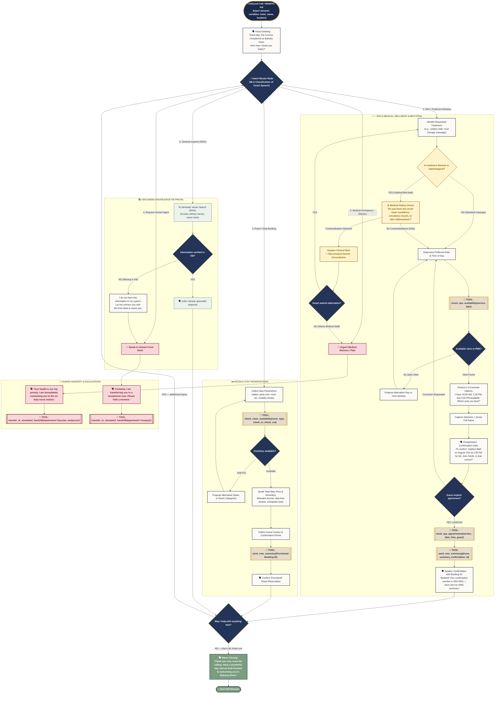

> **Status:** aktualny (2026-11) — tłumaczenie EN dokumentów `docs/elevenlabs_agent_workflow.md` i `docs/elevenlabs_agent_procedures.md` (wersja źródłowa: PL).
>
> **Graph scope (read this first):** the Mermaid graph in §1 describes the **designed** conversational graph (target state, ~30 states). The graph **actually deployed and live** on the agent is a minimal **workflow v3: 3 nodes** (`start` → `main_agent` → `end`) and **2 edges**, defined in `.planning/workflow/workflow_v3.json`. §2 lists the 7 procedures that are published on the live agent.

# Agent Workflows & Standard Operating Procedures (SOP) — Virtual AI Receptionist "Bukowy Dwór"

> Complete technical specification for conversation flow graphs (**ElevenLabs Agent Workflows**) and dynamic standard operating procedures (**ElevenLabs Agent Procedures**) translated to English.

---

## 1. Conversational Graph Workflow (Mermaid.js)

---

## 2. Catalog of 7 Enterprise Standard Operating Procedures (SOP)

| # | Procedure (published name) | Procedure ID | Trigger Condition | Business Logic & Operational Steps |
|---|---|---|---|---|
| **1** | **`procedura_anulowania_rezerwacji_spa`** | `agtprc_5301m0r0e03mfy5b2se1afbye78z` | Guest requests to cancel a scheduled spa treatment or massage. | **>2h before:** free cancellation, releases the slot in the PMS calendar. **<2h before:** **50%** fee, **EXCEPT** for a sudden medical condition/pain or doctor's release (`medical_release: true`) → **0%**. Dispatches SMS summary. |
| **2** | **`procedura_zmiany_terminu_zabiegu`** | `agtprc_9001m0r0e0a5f4fv2j88e8ewz9t1` | Guest requests to move a treatment to a different hour or day. | Queries PMS slots (`check_spa_availability`) → offers 2-3 concrete options → rebooks → sends SMS with the new appointment time. Rescheduling is free of charge. |
| **3** | **`procedura_odwolania_pobytu_i_zwrotu_zadatku`** | `agtprc_0701m0r0e0gre1ra8jhh51xm1pan` | Guest cancels a room stay and asks about the 30% deposit refund. | **>14 days before:** 100% refund OR **110% Future Stay Voucher**. **7–14 days before:** 50% refund OR **100% voucher** (12 months). **<7 days:** non-refundable (exception: medical hospitalization → handoff to the Manager). |
| **4** | **`procedura_wczesnego_przyjazdu_i_poznego_wyjazdu`** | `agtprc_3701m0r0e0qnfpf9ysz2g5a62trs` | Arriving before 3:00 PM (e.g. morning train) or departing after 11:00 AM. | **Early check-in:** free luggage storage + free access to thermal pools and dining from 9:00 AM; room early for free if already cleaned. **Late check-out:** until 2:00 PM — **50 PLN**; until 6:00 PM — **100 PLN** (subject to availability). |
| **5** | **`procedura_zgloszenia_diety_leczniczej`** | `agtprc_8001m0r0e0yff679gj7sxvdgd1sk` | Guest reports diabetes, a light/easily digestible diet, or a gluten- and dairy-free diet. | Three medical diets are included in the stay at no extra charge under clinical dietitian supervision. The gluten- and dairy-free menu must be registered at least 3 days before arrival. Communicates meal times. |
| **6** | **`procedura_zamowienia_transportu_i_meleksa`** | `agtprc_7001m0r0e15kfv28bnc9x9x3p11t` | Guest requests pickup from the Krynica-Zdrój train/bus station or an electric golf cart on premises. | Free dedicated electric shuttle (melex) for resort guests, available 24h. Logs arrival time, luggage count, wheelchair/mobility aid details → sends SMS with the driver's direct contact. |
| **7** | **`procedura_reklamacji_i_trudnego_goscia`** | `agtprc_1801m0r0e1c1enmvsrcttyh36jq7` | Guest is dissatisfied, reports a technical defect, noise, or a service issue. | Active listening without interrupting → genuine institutional apology → immediate service ticket dispatched → complimentary herbal tea / salt cave pass and handoff to the Duty Manager. |

> IDs are the published procedure IDs stored in `.planning/workflow/procedure_ids.json`.
