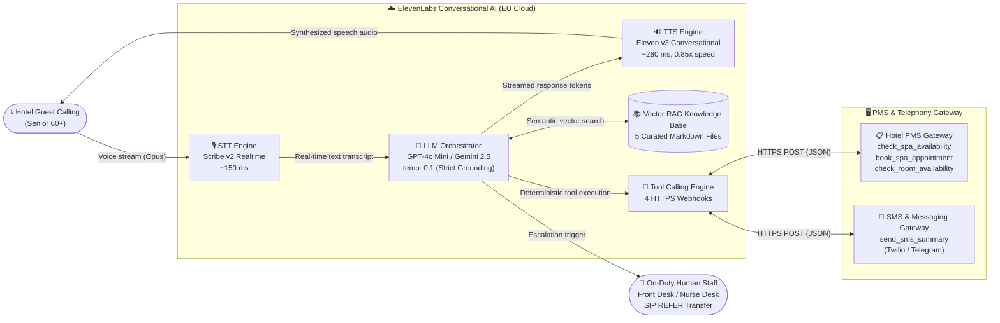
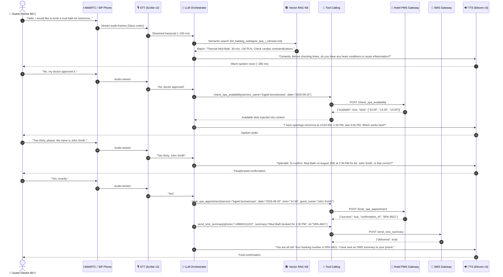
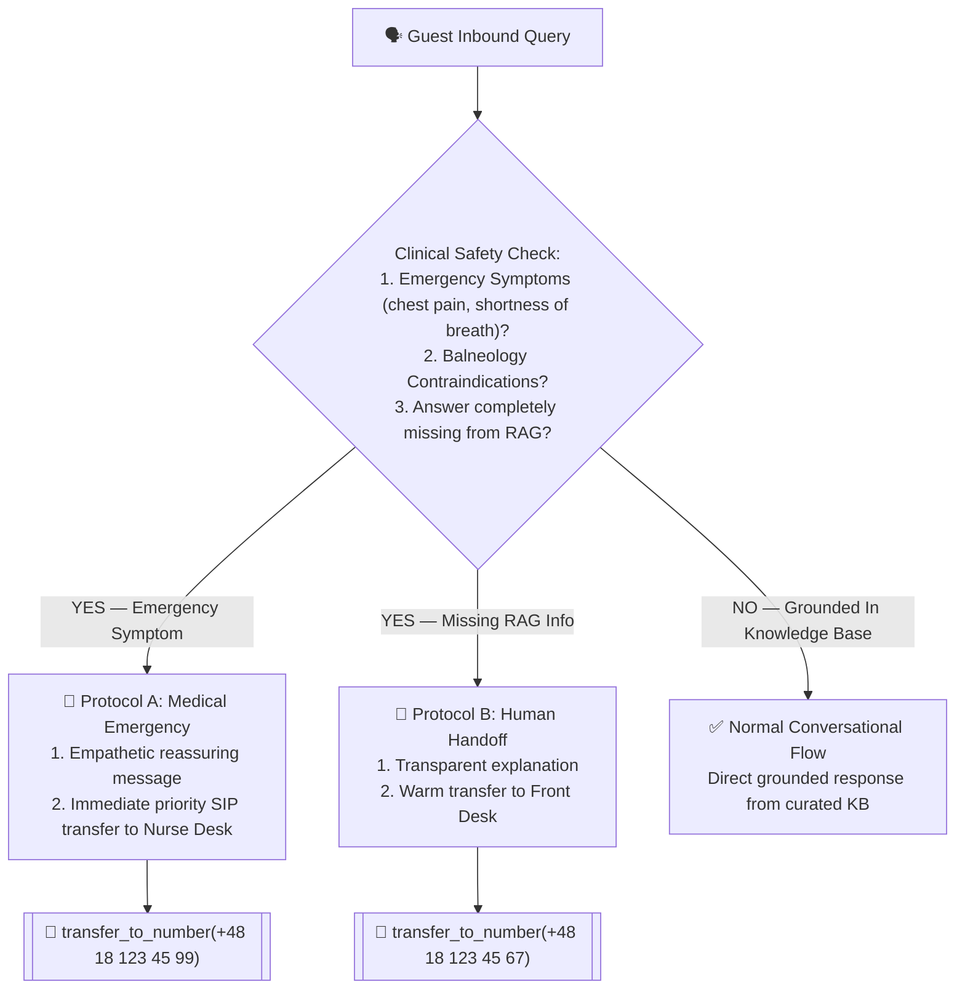
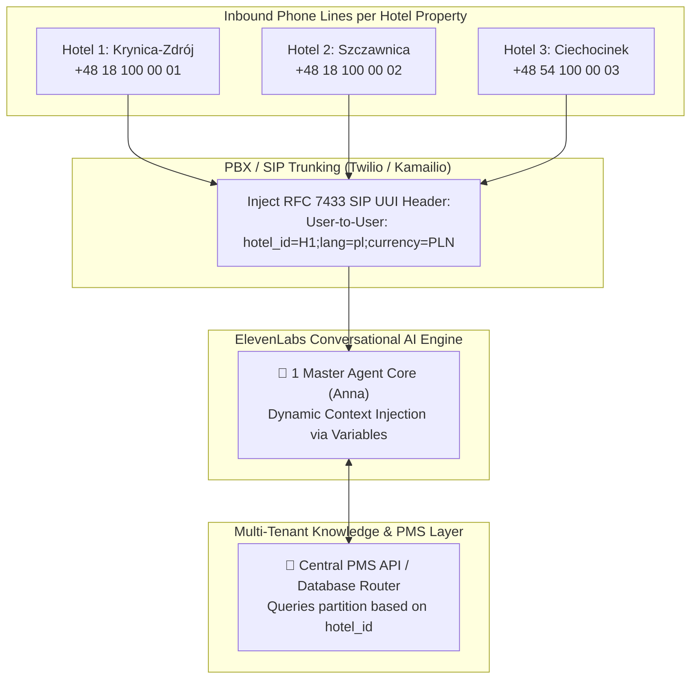
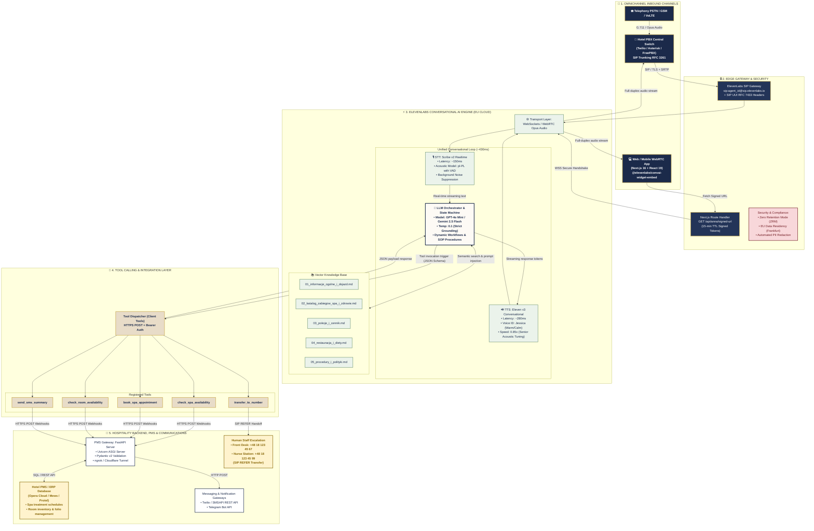

# Architecture Diagrams — Virtual AI Receptionist "Bukowy Dwór"

> Production-ready Mermaid.js diagrams translated to English for presentation slides, technical documentation, system design reviews, and Excalidraw whiteboarding.

---

## DIAGRAM 1 — High-Level Conversational Flow (Unified AI Loop)

---

## DIAGRAM 2 — Detailed Sequence Diagram (SPA Booking & Tool Invocation)

---

## DIAGRAM 3 — Medical Escalation Protocol (Strict Grounding & Safety)

---

## DIAGRAM 4 — Multi-Tenant Hotel Chain Scaling (Sub-Linear Architecture)

---

## DIAGRAM 5 — Complete End-to-End Enterprise Tech Stack

