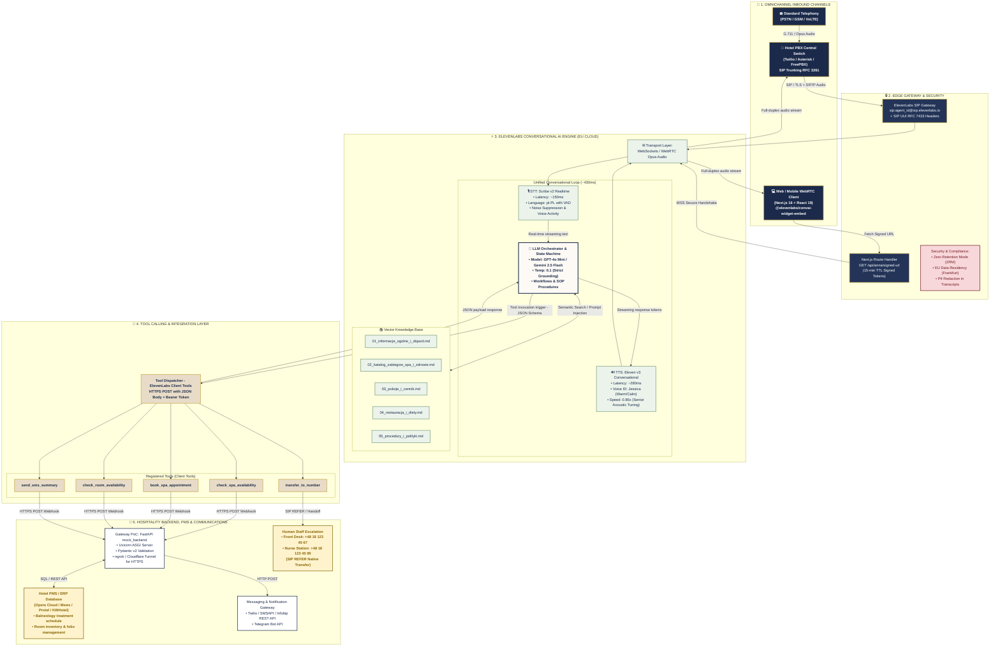

> **Status:** aktualny (2026-11) — tłumaczenie EN dokumentu `docs/architektura_stack_technologiczny.md` (wersja źródłowa: PL).

# Enterprise System Architecture & Tech Stack — Virtual AI Receptionist (Bukowy Dwór)

> Technical implementation reference, enterprise architecture, interfaces, connectors, and communication protocols connecting **ElevenLabs Conversational AI** with hotel and medical resort infrastructure.

---

## 1. End-to-End Architectural Overview

The system is built upon the **Cloud-Native Unified Conversational Loop** paradigm, eliminating the multi-second latency typical of traditional cascaded pipelines (STT → External LLM → TTS).

The architecture spans 5 core layers:
1. **Omnichannel Inbound Layer** — Telephony SIP Trunking (RFC 3261) and Web/Mobile WebRTC full-duplex audio.
2. **Edge Security & Authorization Layer** — 15-min TTL Signed URLs, Zero Retention Mode (ZRM), and EU Data Residency.
3. **ElevenLabs AI Core Engine** — Unified STT (Scribe v2), LLM Orchestrator (GPT-4o Mini / Gemini 2.5), Vector RAG, and Emotional TTS (Eleven v3 Conversational).
4. **Tool Calling & Integration Layer** — Deterministic HTTPS POST Webhooks, JSON Schema parameter validation, and SIP REFER call handoff.
5. **Hospitality Enterprise Systems** — Hotel PMS/ERP database (e.g., Opera Cloud, Mews, Protel, KWHotel), SMS dispatch gateways (Twilio / SMSAPI), and on-duty medical staff.

---

## 2. Mermaid.js System Architecture Diagram



---

## 3. Comprehensive Tech Stack Specifications

### A. Client & Web Experience
- **Framework:** Next.js 16 (App Router), React 19, TypeScript 5.
- **Styling:** Tailwind CSS v4, Radix UI Primitives, Lucide Icons.
- **Voice SDK:** `@elevenlabs/convai-widget-embed` (0.16.4+).
- **Transport Security:** Next.js Server Route Handler `GET /api/anna/signed-url` generates temporary Signed WebRTC/WSS URLs with 15-minute TTL without exposing server `xi-api-key`.

### B. Telephony Gateway & SIP Trunking
- **Protocols:** SIP Trunking (RFC 3261) with TLS and SRTP encryption.
- **Telco Infrastructure:** Twilio Elastic SIP Trunking / Kamailio SBC / Asterisk PBX.
- **Multi-Tenant Context Injection:** Uses **RFC 7433 SIP UUI (User-to-User Information)** header to pass property parameters in-band:
  ```http
  User-to-User: hotel_id=bukowy_dwor;ani=+48600111222;lang=pl-PL;encoding=hex
  ```
- **Call Escalation:** Native `SIP REFER` executes warm transfers to physical receptionists or emergency medical staff without terminating the underlying trunk line.

### C. ElevenLabs Conversational AI Engine
- **Speech-to-Text (STT):** `Scribe v2 Realtime` (~150ms latency, Polish balneology vocabulary customization, robust noise suppression).
- **LLM Reasoning:** `GPT-4o Mini` / `Gemini 2.5 Flash` (temperature 0.1, strict grounding system prompt, dynamic workflow state machines).
- **Knowledge Base (RAG):** 5 Markdown files partitioned into `prompt` mode (critical safety rules & base pricing) and `auto` mode (semantic vector retrieval).
- **Text-to-Speech (TTS):** `Eleven v3 Conversational` (~280ms latency, voice ID Jessica `cgSgspJ2msm6clMCkdW9`, pacing calibrated to 0.85x for senior cognitive comfort).

### D. Tool Calling & Webhook Connectors
- **Communication:** Outbound HTTPS POST requests from ElevenLabs cloud with JSON payload and Bearer token / HMAC authentication.
- **5 Client Tools:**
  1. `check_spa_availability(service_name, date)` → Queries real-time slot calendar in PMS.
  2. `book_spa_appointment(service_name, date, time, guest_name)` → Locks slot, creates folio, returns `SPA-XXXX`.
  3. `check_room_availability(room_type, check_in, check_out)` → Checks room inventory and total pricing.
  4. `send_sms_summary(phone_number, summary_text, id)` → Dispatches SMS/Telegram confirmation.
  5. `transfer_to_number(phone_number)` → Initiates SIP transfer to human desk.

### E. Enterprise Security & GDPR Compliance
- **Zero Retention Mode (ZRM):** Audio streams are processed strictly in volatile RAM and destroyed upon session termination.
- **Conversation History Redaction:** Automated masking of PII (national IDs, phone numbers, health notes) in log storage.
- **EU Data Residency:** All compute, model inference, and vector embeddings reside strictly within EU regions (Frankfurt / Dublin).
