> **Status:** aktualny (2026-11) — źródło prawdy dla architektury systemu i stacku technologicznego.

# Architektura Systemowa i Stack Technologiczny — Wirtualna Recepcjonistka AI (Bukowy Dwór)

> Kompleksowa dokumentacja techniczna architektury wdrożeniowej, stosu technologicznego, interfejsów, konektorów i protokołów komunikacyjnych łączących platformę **ElevenLabs Conversational AI** z infrastrukturą hotelową i medyczną uzdrowiska.

---

## 1. Przegląd Architektury End-to-End

Architektura została zaprojektowana w oparciu o paradygmat **Natywnego Agenta Chmurowego (Cloud-Native Unified Conversational Loop)**, eliminując opóźnienia tradycyjnych kaskad wielomodelowych.

System łączy 5 głównych warstw:
1. **Warstwa Interfejsów Wejściowych (Omnichannel Inbound)** — Telefonia SIP oraz Web/Mobile WebRTC.
2. **Warstwa Bezpieczeństwa & Autoryzacji (Edge Gateway)** — Signed URLs, ZRM, EU Data Residency.
3. **Rdzeń Konwersacyjny ElevenLabs (AI Core Engine)** — Zunifikowane STT + LLM Orchestrator + RAG + TTS.
4. **Warstwa Integracji i Webhooków (Integration Layer)** — Tool Calling, REST API, bramka FastAPI.
5. **Systemy Źródłowe Enterprise (PMS, CRM, Telco, SMS)** — Hotelowy PMS, terminarz zabiegów balneologicznych, bramki SMS/Telegram, PBX.

---

## 2. Diagram Architektury Mermaid.js (Full Tech Stack)

Poniższy diagram przedstawia kompletny przepływ danych, użyte protokoły, interfejsy oraz konektory:

```mermaid
flowchart TB
    %% ==========================================
    %% DEFINICJE STYLÓW I PALETY
    %% ==========================================
    classDef clientLayer fill:#1B2A4A,stroke:#C9A84C,stroke-width:2px,color:#FFFFFF,font-weight:bold;
    classDef edgeLayer fill:#233458,stroke:#C9A84C,stroke-width:2px,color:#FFFFFF;
    classDef aiCore fill:#FDFAF5,stroke:#1B2A4A,stroke-width:3px,color:#1B2A4A,font-weight:bold;
    classDef aiSub fill:#EBF3EB,stroke:#7A9E7E,stroke-width:2px,color:#1B2A4A;
    classDef webhookLayer fill:#E8DCC8,stroke:#C9A84C,stroke-width:2px,color:#1B2A4A,font-weight:bold;
    classDef backendLayer fill:#FFFFFF,stroke:#1B2A4A,stroke-width:2px,color:#1B2A4A;
    classDef pmsLayer fill:#FFF3CD,stroke:#856404,stroke-width:2px,color:#856404,font-weight:bold;
    classDef secLayer fill:#F8D7DA,stroke:#721C24,stroke-width:2px,color:#721C24;

    %% ==========================================
    %% 1. WARSTWA KLIENTA / INBOUND
    %% ==========================================
    subgraph INBOUND ["📱 1. OMNICHANNEL INBOUND CHANNELS"]
        direction LR
        PHONE["☎️ Telefonia Tradycyjna\n(PSTN / GSM / VoLTE)"]:::clientLayer
        SIP_TRUNK["🏢 Centrala Hotelowa PBX\n(Twilio / Asterisk / FreePBX)\nSIP Trunking RFC 3261"]:::clientLayer
        WEB_CLIENT["💻 Przeglądarka Web / Mobile\n(Next.js 16 + React 19)\n`@elevenlabs/convai-widget-embed`"]:::clientLayer
        
        PHONE -->|G.711 / Opus Audio| SIP_TRUNK
    end

    %% ==========================================
    %% 2. WARSTWA BEZPIECZEŃSTWA & EDGE
    %% ==========================================
    subgraph EDGE ["🔒 2. EDGE GATEWAY & AUTORYZACJA"]
        direction TB
        SIP_URI["SIP Gateway ElevenLabs\n`sip:agent_id@sip.elevenlabs.io`\n+ Nagłówki SIP UUI (RFC 7433)"]:::edgeLayer
        SIGNED_URL_API["Next.js Route Handler\n`GET /api/anna/signed-url`\n(15-min TTL Signed Tokens)"]:::edgeLayer
        SEC_POL["Polityka Bezpieczeństwa:\n• Zero Retention Mode (ZRM)\n• EU Data Residency (Frankfurt)\n• PII Redaction w transkrypcjach"]:::secLayer
    end

    SIP_TRUNK -->|"SIP / TLS + SRTP Audio"| SIP_URI
    WEB_CLIENT -->|"Fetch Signed URL"| SIGNED_URL_API
    SIGNED_URL_API -->|"WSS Secure Handshake"| WSS_CONN

    %% ==========================================
    %% 3. ELEVENLABS AI CORE (ZUNIFIKOWANA PĘTLA)
    %% ==========================================
    subgraph AI_CORE ["⚡ 3. ELEVENLABS CONVERSATIONAL AI ENGINE (EU CLOUD)"]
        direction TB
        
        WSS_CONN["🌐 Transport Layer:<br/>WebSockets / WebRTC Opus Audio"]:::aiSub
        
        subgraph LOOP ["Zunifikowana Pętla Konwersacyjna (~430ms)"]
            STT["🎙️ STT: Scribe v2 Realtime<br/>• Latencja: ~150ms<br/>• Język: pl-PL z VAD<br/>• Szumotłumienie & Voice Activity"]:::aiSub
            
            ORCHESTRATOR["🧠 LLM Orchestrator & State Machine<br/>• Model: Gemini 3.5 Flash Lite<br/>• Temp: 0.1 (Strict Grounding)<br/>• Workflows & Procedury SOP"]:::aiCore
            
            TTS["🔊 TTS: Eleven v3 Conversational<br/>• Latencja: ~280ms<br/>• Voice ID: Jessica (Warm/Calm)<br/>• Speed: 0.85x (Optymalizacja Senior 60+)"]:::aiSub
            
            STT -->|"Transkrypcja tekstu w locie"| ORCHESTRATOR
            ORCHESTRATOR -->|"Strumień tokenów odpowiedzi"| TTS
        end

        subgraph RAG_KB ["📚 Baza Wiedzy RAG (Vector Engine)"]
            KB1["01_informacje_ogolne_i_dojazd.md"]:::aiSub
            KB2["02_katalog_zabiegow_spa_i_zdrowie.md"]:::aiSub
            KB3["03_pokoje_i_cennik.md"]:::aiSub
            KB4["04_restauracja_i_diety.md"]:::aiSub
            KB5["05_procedury_i_polityki.md"]:::aiSub
        end

        ORCHESTRATOR <-->|"Semantic Search / Prompt Injection"| RAG_KB
    end

    SIP_URI --> WSS_CONN
    WSS_CONN --> STT
    TTS --> WSS_CONN
    WSS_CONN -->|"Zwrotny strumień audio"| WEB_CLIENT
    WSS_CONN -->|"Zwrotny strumień audio"| SIP_TRUNK

    %% ==========================================
    %% 4. WARSTWA INTEGRACJI & WEBHOOKI
    %% ==========================================
    subgraph INTEGRATION ["🔧 4. TOOL CALLING & INTEGRATION LAYER"]
        direction TB
        TOOL_ROUTER["Tool Dispatcher - ElevenLabs Client Tools<br/>HTTPS POST z JSON Body + Bearer Token"]:::webhookLayer
        
        subgraph TOOLS ["Zarejestrowane Narzędzia (Client Tools)"]
            T1["check_spa_availability"]:::webhookLayer
            T2["book_spa_appointment"]:::webhookLayer
            T2B["cancel_spa_appointment"]:::webhookLayer
            T2C["reschedule_spa_appointment"]:::webhookLayer
            T3["check_room_availability"]:::webhookLayer
            T4["send_sms_summary"]:::webhookLayer
            T5["transfer_to_simulated_handoff"]:::webhookLayer
        end

        TOOL_ROUTER --> T1
        TOOL_ROUTER --> T2
        TOOL_ROUTER --> T2B
        TOOL_ROUTER --> T2C
        TOOL_ROUTER --> T3
        TOOL_ROUTER --> T4
        TOOL_ROUTER --> T5
    end

    ORCHESTRATOR -->|"Wykrycie intencji akcji - JSON Schema"| TOOL_ROUTER
    TOOL_ROUTER -->|"Odpowiedź z danymi JSON"| ORCHESTRATOR

    %% ==========================================
    %% 5. BACKEND, PMS & USŁUGI ZEWNĘTRZNE
    %% ==========================================
    subgraph BACKEND ["🏨 5. SYSTEMY HOTELOWE, PMS & KOMUNIKACJA"]
        direction TB
        
        FASTAPI_GW["Gateway PoC: FastAPI mock_backend<br/>• Uvicorn ASGI Server, port 8011<br/>• 7 tras POST + 2 GET (/ , /health)<br/>• Walidacja Pydantic<br/>• ngrok / Cloudflare Tunnel dla HTTPS"]:::backendLayer
        
        PMS_CORE["Hotelowy System PMS / ERP<br/>(np. Protel, KWHotel, Mews, Opera Cloud)<br/>• Kalendarz zabiegów balneologicznych<br/>• Stan obłożenia pokoi i rezerwacje"]:::pmsLayer
        
        SMS_GW["Bramka SMS / Komunikatory<br/>• Twilio / SMSAPI / Infobip REST API<br/>• Telegram Bot API"]:::backendLayer
        
        HUMAN_ESC["Przełączenie na Żywego Człowieka<br/>• Recepcja Główna: +48 18 123 45 67<br/>• Dyżurka Medyczna: +48 18 123 45 99<br/>(docelowo SIP REFER — w PoC handoff symulowany)"]:::pmsLayer
    end

    T1 -->|"HTTPS POST Webhook"| FASTAPI_GW
    T2 -->|"HTTPS POST Webhook"| FASTAPI_GW
    T2B -->|"HTTPS POST Webhook"| FASTAPI_GW
    T2C -->|"HTTPS POST Webhook"| FASTAPI_GW
    T3 -->|"HTTPS POST Webhook"| FASTAPI_GW
    T4 -->|"HTTPS POST Webhook"| FASTAPI_GW
    FASTAPI_GW <-->|"SQL / REST API"| PMS_CORE
    FASTAPI_GW -->|"HTTP POST"| SMS_GW
    T5 -->|"HTTPS POST (handoff symulowany)"| HUMAN_ESC
```



---

## 3. Szczegółowy Opis Stosu Technologicznego

### A. Warstwa Kliencka (Frontend & Web Widget)
- **Framework:** Next.js 16 (App Router) z React 19 i TypeScript 5.
- **Styling & UI:** Tailwind CSS v4, Radix UI Primitives, Lucide Icons.
- **ElevenLabs SDK:** Oficjalny komponent webowy `@elevenlabs/convai-widget-embed` (wersja 0.16.4+).
- **Zarządzanie Połączeniem:**
  - `GET /api/anna/signed-url` — Bezpieczny backendowy endpoint w Next.js generujący podpisany URL (`wss://...`) z kluczem API ukrytym na serwerze (`ELEVENLABS_API_KEY`).
  - WebSockets / WebRTC w pełnym dupleksie ze strumieniowaniem próbek audio w formacie Opus / PCM.

---

### B. Warstwa Telefonii (Telephony & Voice Gateway)
- **Protokół:** SIP Trunking (Session Initiation Protocol — RFC 3261) zabezpieczony TLS + SRTP (Secure Real-time Transport Protocol).
- **Dostawca Telco:** Twilio Elastic SIP Trunking / Centrala Asterisk / FreePBX.
- **Przekazywanie Kontekstu Multi-Hotel:**
  - Wykorzystanie nagłówka **SIP UUI (User-to-User Information — RFC 7433)** do przekazywania zmiennych w locie:
    ```
    User-to-User: hotel_id=bukowy_dwor;ani=+48600111222;lang=pl-PL;encoding=hex
    ```
- **Handoff (Eskalacja):** Docelowo natywna obsługa `SIP REFER`, umożliwiająca natychmiastowe przekierowanie połączenia na telefon stacjonarny recepcji lub dyżurki pielęgniarskiej bez zrywania sesji.
  > **Stan PoC:** telefonii/SIP nie ma — agent działa wyłącznie jako widget webowy, a `transfer_to_number` nie jest podpięty. Eskalacja jest symulowana webhookiem `transfer_to_simulated_handoff` (log + opcjonalny alert Telegram).

---

### C. Rdzeń Sztucznej Inteligencji (ElevenLabs Conversational AI Core)
- **STT (Speech-to-Text):** `Scribe v2 Realtime`
  - Latencja: ~150 ms.
  - Akustyczny model języka polskiego zoptymalizowany pod specyficzne terminy balneologiczne (np. *kąpiel siarczkowa*, *borowina*, *jonoforeza*).
  - Voice Activity Detection (VAD) z czasem oczekiwania `turn_timeout: 3.0s` (brak przerywania seniorom).
- **LLM Orchestrator:** `gemini-3.5-flash-lite`
  - Temperatura: `0.1` (bezwzględny zakaz halucynacji).
  - Mechanizm stanowy: **ElevenLabs Agent Workflows & Procedures** (7 procedur opublikowanych + graf start→main_agent→end).
- **RAG & Knowledge Base:**
  - 5 plików Markdown podzielonych na tryby:
    - `prompt`: procedury operacyjne i cenniki wstrzykiwane na stałe.
    - `auto`: katalog zabiegów i opisy dojazdu pobierane wektorowo (Semantic Chunking).
- **TTS (Text-to-Speech):** `Eleven v3 Conversational`
  - Latencja: ~280 ms.
  - Voice ID: Jessica (`cgSgspJ2msm6clMCkdW9`), stabilność `0.80`, podobieństwo `0.75`.
  - Modyfikator tempa: `0.85x` (ciepła, spokojna wymowa).

---

### D. Warstwa Integracji i Webhooków (Connectors & Tool Calling)

ElevenLabs wywołuje zewnętrzne narzędzia za pomocą schematu **Client Tools (JSON Schema)** przez protokół HTTPS:

| Narzędzie | Typ Protokołu | Endpoint docelowy | Zadanie |
|---|---|---|---|
| **`check_spa_availability`** | HTTPS POST | `/check_spa_availability` | Weryfikacja wolnych slotów w kalendarzu SPA w PMS |
| **`book_spa_appointment`** | HTTPS POST | `/book_spa_appointment` | Zapisanie rezerwacji zabiegu i wygenerowanie kodu `SPA-XXXX` |
| **`cancel_spa_appointment`** | HTTPS POST | `/cancel_spa_appointment` | Anulowanie zabiegu (polityka 2h + zwolnienie medyczne) |
| **`reschedule_spa_appointment`** | HTTPS POST | `/reschedule_spa_appointment` | Zmiana terminu zabiegu (bezpłatna, nowy kod SPA) |
| **`check_room_availability`** | HTTPS POST | `/check_room_availability` | Sprawdzenie obłożenia pokoi i kalkulacja ceny całkowitej |
| **`send_sms_summary`** | HTTPS POST | `/send_sms_summary` | Wysłanie wiadomości SMS/Telegram z potwierdzeniem |
| **`transfer_to_simulated_handoff`** | HTTPS POST | `/transfer_to_simulated_handoff` | Symulowane przekazanie do człowieka (PoC — brak telefonii) |

**Razem 7 narzędzi webhook** (+ wbudowane `end_call`). Nie istnieje narzędzie `transfer_to_human` ani podpięty `transfer_to_number`; handoff do człowieka jest w PoC symulowany.

---

### E. Backend PoC & PMS Gateway (FastAPI)
- **Środowisko:** Python 3.11+, FastAPI, Uvicorn ASGI Server, port **8011** (8000 na hoście deweloperskim zajmuje proces systemowy).
- **Powierzchnia API:** 7 tras `POST` (po jednej na narzędzie agenta) + 2 `GET` (`/` — opis serwisu, `/health` — health check). Swagger UI: `http://localhost:8011/docs`.
- **Model Danych:** Walidacja wejścia za pomocą modeli `Pydantic v2`.
- **Ekspozycja w sieci:**
  - Lokalnie dla agenta chmurowego: Tunel HTTPS za pośrednictwem `ngrok http 8011`, `cloudflared tunnel --url http://localhost:8011` lub stały Cloudflare Tunnel.
  - Produkcyjnie: Konteneryzacja Docker na chmurze Render / AWS ECS / Google Cloud Run.
- **Kanały Notyfikacji:** Asynchroniczne wywołania HTTP do bramki SMS oraz Telegram Bot API (`sendMessage`).

---

## 4. Architektura Bezpieczeństwa Enterprise & RODO

```
           [ Dane Gościa / Głos ]
                     │
                     ▼
         ┌───────────────────────┐
         │ Zero Retention Mode   │ ➔ Audio przetwarzane wyłącznie w pamięci RAM
         │ (ZRM - Zero Disk)     │   (Brak zapisu plików WAV/MP3 na dyskach)
         └───────────────────────┘
                     │
                     ▼
         ┌───────────────────────┐
         │ Conversation History  │ ➔ Automatyczna anonimizacja (maskowanie)
         │ Redaction (PII)       │   numerów PESEL, telefonów, nazwisk w logach
         └───────────────────────┘
                     │
                     ▼
         ┌───────────────────────┐
         │ EU Data Residency     │ ➔ Wszystkie serwery i bazy wektorowe
         │ (Frankfurt / Dublin)  │   zlokalizowane w Europejskim Obszarze Gosp.
         └───────────────────────┘
```

1. **Zero Retention Mode (ZRM):** Głos kuracjusza i strumień audio są przetwarzane wyłącznie w ulotnej pamięci RAM serwerów ElevenLabs w UE i natychmiast niszczone po zakończeniu połączenia.
2. **Conversation Redaction:** Wszelkie dane wrażliwe (np. informacje o stanie zdrowia podane w wywiadzie balneologicznym) są maskowane tokenami `[REDACTED]` w panelu analitycznym.
3. **Signed URLs:** Komunikacja webowa nie ujawnia klucza `xi-api-key` w przeglądarce klienta — każda sesja otrzymuje unikalny token ważny 15 minut.
