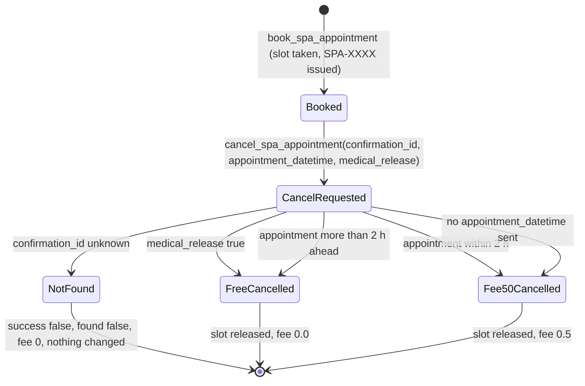

# Cancellation of a SPA appointment

Status: **derived from `procedures_7.md` (procedure 1) and `services/spa.py`; transitions tested offline** in `mock_backend/tests/test_flow_transitions.py`.

## State diagram

## Fee decision (backend, not the model)

Evaluated in order by `oblicz_oplate_anulowania`:

| Order | Condition | Result | `fee_rule` (PL) |
|---|---|---|---|
| 1 | `medical_release = true` | fee 0.0 | Zwolnienie medyczne |
| 2 | `appointment_datetime` missing | fee 0.5 | Brak godziny zabiegu |
| 3 | more than 2 h before the appointment | fee 0.0 | ponad 2h |
| 4 | 2 h or less before (including a time already past) | fee 0.5 | poniżej 2h |

The agent must read `fee`, `free_of_charge` and `fee_rule` from the response and repeat them. It must not calculate the fee itself (prompt rule and procedure step 7).

## Transition table

| From | Trigger | Guard | To | Observable result |
|---|---|---|---|---|
| Booked | cancel | number exists | FreeCancelled / Fee50Cancelled | `success: true`, `cancelled: true`, slot back in the free list |
| Booked | cancel | number unknown | NotFound | `success: false`, `found: false`, `fee: 0.0`; other bookings untouched |
| Cancelled | cancel again | number already released | NotFound | same as above |

## Test coverage

| Transition | Test |
|---|---|
| Free cancel, slot released | `test_cancel_more_than_2h_before_is_free_and_frees_the_slot` |
| 50 % inside 2 h | `test_cancel_less_than_2h_before_charges_50_percent` |
| Medical release inside 2 h | `test_cancel_with_medical_release_is_free_even_inside_2h` |
| Missing time → 50 % | `test_cancel_without_appointment_time_is_charged_50_percent` |
| Unknown number → rejection | `test_cancel_nonexistent_booking_is_business_rejection_not_error` |
| Unknown number does not free another slot | `test_cancel_nonexistent_does_not_touch_an_existing_booking` |
| Double cancel | `test_second_cancel_of_the_same_booking_is_rejected` |

## Limits

- The cancel request has no guest name field. Identity verification is a prompt step (procedure 1, step 1 and the guardrail "verify before change"), not a backend check.
- Fee values are fractions (0.0 or 0.5) and the backend's own rules. The business owner must confirm them against the spa's terms; they are not legal advice.
- State lives in process memory.
