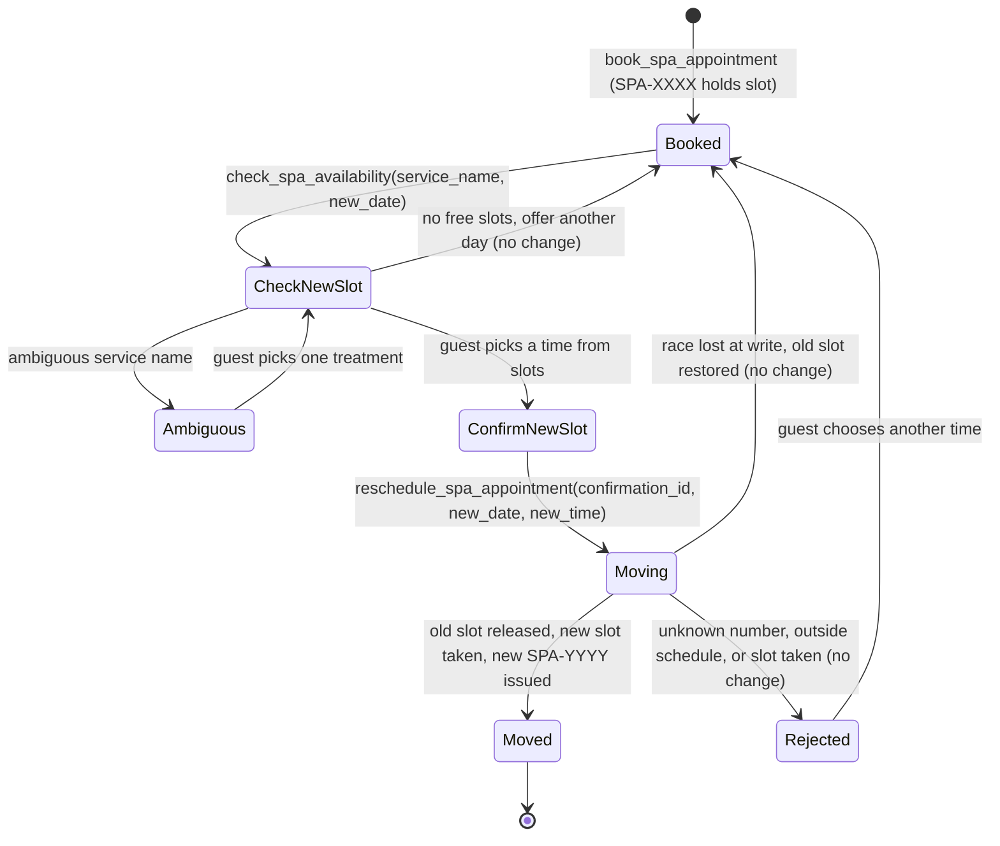

# Rescheduling a SPA appointment

Status: **derived from `procedures_7.md` (procedure 2) and `services/spa.py`; transitions tested offline** in `mock_backend/tests/test_flow_transitions.py`.

## State diagram

`SPA-YYYY` in the diagram stands for the new confirmation number (`confirmation_id` in the response). The old number stops working.

## Backend order of checks (`przenies_rezerwacje`)

| Step | Check | Failure powod | Effect |
|---|---|---|---|
| 1 | old number exists | `nie_znaleziono` | none |
| 2 | service name resolves | `niejednoznaczny` / `nieznany` | none |
| 3 | new date not in the past | `przeszlosc` | none |
| 4 | new date inside the 14-day window | `poza_oknem` | none |
| 5 | new time is in the service schedule | `poza_grafikiem` | none |
| 6 | new slot is free | `zajety` (returns free `wolne` list) | none |
| 7 | release old slot, take new slot | `wyscig` if the write fails | old slot restored |

A success response carries the new `confirmation_id`, `previous_confirmation_id` and the `note` "Zmiana terminu jest bezpłatna."

## Transition table

| From | Trigger | Guard | To | Observable result |
|---|---|---|---|---|
| Booked | reschedule | all checks pass | Moved | `success: true`, new number, old slot free, new slot taken |
| Booked | reschedule | slot taken | Rejected | `success: false`, message contains "zajęty", old booking kept |
| (none) | reschedule | number unknown | Rejected | `success: false`, `found: false`, no slot touched |
| Booked | reschedule | time outside schedule | Rejected | `success: false`, old booking kept |

## Test coverage

| Transition | Test |
|---|---|
| Moved: new number, slot swap | `test_reschedule_issues_new_number_and_moves_the_slot` |
| Old number invalid after move | `test_old_number_is_gone_after_reschedule` |
| New number can be cancelled | `test_rescheduled_booking_can_be_cancelled_with_its_new_number` |
| Taken slot rejected, old booking kept | `test_reschedule_to_taken_slot_is_rejected_and_keeps_the_old_booking` |
| Unknown number creates nothing | `test_reschedule_of_unknown_number_is_rejected_without_creating_a_booking` |
| Outside schedule rejected | `test_reschedule_to_a_time_outside_the_service_schedule_is_rejected` |

## Limits

- The race branch (`wyscig`) is hard to hit with a single worker and is not covered by a test in this file. Concurrency is tracked as a separate follow-up.
- No idempotency key on reschedule: a retry after a timeout can move the booking a second time. The booking endpoint has a key; this one does not.
- The "first change is free" rule from the prompt is not implemented in the backend. Here every reschedule is free.
