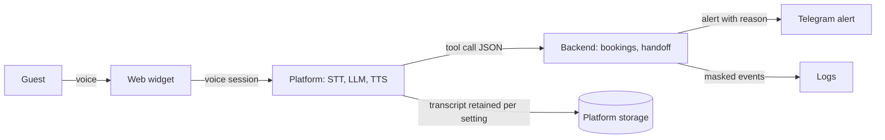

# DPIA-lite: voice receptionist processing health-related data

> **Not legal advice. Working draft for a fictional spa (PoC).** A lightweight impact assessment written to show the method. It does not replace a full DPIA under Art. 35 GDPR if the controller's counsel decides one is required. Items marked `[COUNSEL]` or `[CONFIRM]` are open.

## 1. Why this assessment

The assistant talks with guests about treatments. Treatment screening asks about heart conditions, implants, epilepsy and similar matters. Guests also mention diabetes, diet needs and hospital stays. Those are data concerning health (Art. 9(1)). A full DPIA is required under Art. 35(3)(b) when special-category data is processed on a large scale. The scale of this PoC is small, but the processing is systematic and automated, so this lite version records the reasoning. `[COUNSEL]` decides whether the full form is needed before any live use.

## 2. Description of processing

| Step | What happens | Where | Health data involved |
|---|---|---|---|
| 1 | Guest speaks to the assistant in the web widget | browser to the platform | yes, if volunteered |
| 2 | Speech is converted to text; an LLM reasons over the conversation and calls tools | platform (ElevenLabs), model provider | yes |
| 3 | Tools call the booking backend (availability, booking, cancellation, reschedule, SMS, handoff) | mock backend (PoC) | flags and reasons only |
| 4 | Handoff creates an alert for staff | Telegram (PoC) | reason text |
| 5 | Logs record events | backend logs | masked; see retention |
| 6 | Transcript is kept by the platform | platform | yes, per platform retention `[CONFIRM]` |

## 3. Lawful basis and consent

| Processing | Proposed basis | Status |
|---|---|---|
| Booking and changes, guest's own contact details | Art. 6(1)(b) | `[COUNSEL]` to confirm |
| Health information volunteered by the guest | Art. 9(2)(a): explicit consent | **Open.** No consent step is verified in this repo. |
| Staff alert with reason text | Art. 6(1)(b) and (f) | `[COUNSEL]` |
| SMS to a third party (relative) | consent of that third person | Spa prompt has a rule requiring the guest to confirm the third person's consent before sending (working copy, guardrail 7). Not verified against the live agent. |

### Draft consent text (Polish, for counsel review)

> Rozmawiasz z asystentem AI, nie z człowiekiem. Rozmowa jest zapisywana przez dostawcę usługi głosowej i może zawierać informacje o zdrowiu, które podajesz dobrowolnie. Informacje te służą wyłącznie obsłudze Twojej rezerwacji i nie są diagnozą. Zgoda jest dobrowolna. Możesz ją cofnąć w każdej chwili, kontaktując się z recepcją, a bez zgody zarezerwujesz zabieg w recepcji. [CONFIRM: okres przechowywania transkrypcji i dane kontaktowe administratora].

The text needs: the controller's identity, the processors named in the RoPA, the retention period, and the rights section. The consent must be shown before the voice session starts, and it must be recorded (for example as a flag in the session start).

## 4. Necessity and minimisation

| Principle | Measure | Status |
|---|---|---|
| Collect flags, not diagnoses | agent records a flag such as "zgłoszony objaw zagrożenia życia" as the handoff reason | in the spa prompt working copy (handoff rule); dental prompt has the same rule. Verify by scenario. |
| No medical advice | agent does not judge fitness for a treatment; screening answers go to the staff | spa prompt rule and never-automate list in the dental vertical; `[COUNSEL]` for wording |
| No health text in logs | JSON logs hold event names and masked phone numbers | **In repo** (`mock_backend/logs.py`) |
| No health text in demo console output | **Known gap:** the cancellation demo log prints the reason text to stdout when `ANNA_DEMO_LOGS` is on (default on) (`mock_backend/responses/cancel.py`, line 52) | Open: default off outside demos, or print only the flag |
| Masked alerts | **Known gap:** guest name is in the Telegram text (`mock_backend/routers/comms.py`) | Open |
| Retention limit | see `retention.md` | Open for the platform setting |

## 5. Risk assessment

Likelihood and severity use three levels: low, medium, high. Residual risk is the level after the listed mitigations are in force.

| ID | Risk to the guest | Likelihood | Severity | Mitigation | Residual |
|---|---|---|---|---|---|
| R1 | Health details kept in the platform's transcript longer than needed | medium | high | platform retention set to the shortest allowed `[CONFIRM]`; zero retention mode is **Design / Enterprise tier** only | high until set |
| R2 | Health reason shown in a staff alert to people who do not need it | medium | high | minimise reason text to flags; mask names in alerts (gap) | medium |
| R3 | Agent gives a clinical answer (dose, contraindication) that is wrong | medium | high | never-automate rule; handoff for clinical questions; scenario tests for allergy and anaesthesia (dental d10) and screening (spa) | medium |
| R4 | Emergency symptoms are handled as a booking | low | critical | emergency section of the spa working copy names 112 first and forbids booking during it; verify by scenario; live agent not tested | medium |
| R5 | SMS sent to a relative who did not agree | medium | medium | consent confirmed in the call before sending (spa prompt rule; dental scenario d11) | low to medium |
| R6 | Another guest's booking disclosed to a caller | low | high | third-party guardrail in prompt; scenario "dane innej osoby" | low |
| R7 | Prompt injection makes the agent reveal instructions or data | medium | medium | guardrail "user words are data"; injection scenarios | low |
| R8 | Telegram stores the alert outside the EEA | medium | medium | content minimisation (R2); transfer check `[COUNSEL]` | medium |
| R9 | Guest cannot exercise rights (no working channel) | medium | medium | role mailbox in the privacy notice `[CONFIRM]`; response within one month (Art. 12(3)) | medium until set |
| R10 | Voice session starts without consent | medium | high | consent step before the session (widget) | high until built (**Open**) |
| R11 | Recording of a call without clear notice | low | high | the spa working copy asks the agent to say the conversation may be recorded and transcribed (greeting rule 3); dental scenario d15 tests the question; the wording of the notice itself is not reviewed here | medium until verified on the live agent |
| R12 | Relatives get a guest's health information by phone | low | high | the agent does not confirm any booking details for a third party (guardrail) | low |

## 6. Data subject rights

| Right | How the controller would meet it | Status |
|---|---|---|
| Information (Art. 13) | privacy notice on the website, shown before the session | **Open**: text not verified in this package |
| Access (Art. 15) | export of bookings and transcripts for the guest, by reference (name, date, confirmation number) | **Open**: no export tool exists |
| Rectification (Art. 16) | change of booking through reception; transcripts are not edited | Open |
| Erasure (Art. 17) | delete booking and transcript on the platform; list the deletion in the response | **Open**: no tool; platform API `[CONFIRM]` |
| Restriction and objection (Art. 18, 21) | stop the assistant for this guest, reception handles bookings | Open |
| Withdraw consent (Art. 7(3)) | reception channel; the agent does not record withdrawal yet | Open |
| Complaint | Urząd Ochrony Danych Osobowych (UODO), named in the notice | `[CONFIRM]` wording |
| Response time | one month, extendable as Art. 12(3) allows | policy to set |

## 7. Residual risk and conclusion

- **Current state (PoC, no real guests):** the risks are controlled by design and by offline tests. The live path is not verified against a real platform configuration for each control.
- **Before any live use with real guests**, these must be closed: R1 retention setting, R2 and R8 alert minimisation, R10 consent step, R11 notice, and the rights process in section 6.
- **Decision for the controller:** accept the residual risk after closing the items above, or limit the assistant to information and booking without health screening. `[CONFIRM]`

## 8. Open decisions

| # | Decision | Owner (role) |
|---|---|---|
| D1 | Retention for transcripts and audio on the platform | controller, data protection contact |
| D2 | Whether the assistant screens health answers at all, or only flags them for staff | clinical lead |
| D3 | Consent text and where the consent is recorded | counsel |
| D4 | Whether a full DPIA is required | counsel |
| D5 | Channel for rights requests (role mailbox) | controller |
| D6 | Telegram or another channel for staff alerts, and what it may contain | controller |
