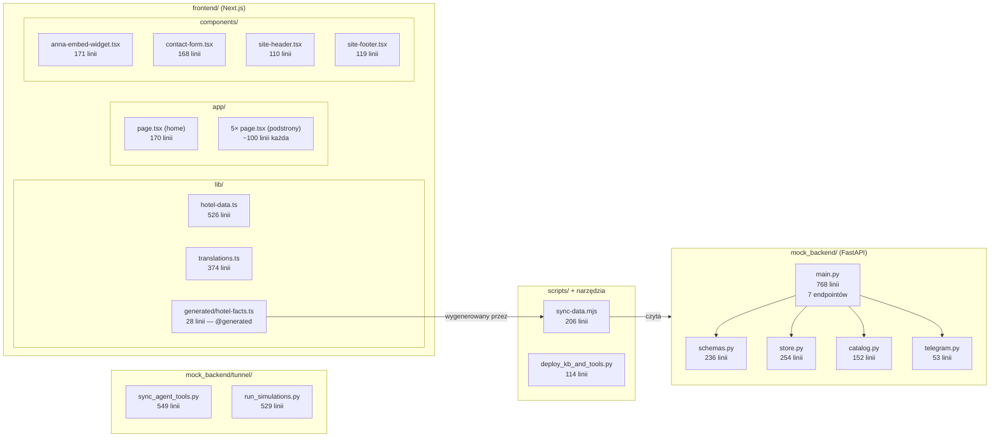

# Dogłębna Analiza Refaktoryzacji — SpaHotels / Bukowy Dwór AI PoC

> [!NOTE]
> Analiza oparta na pełnym odczycie wszystkich plików projektu: `main.py`, `schemas.py`, `store.py`,
> `catalog.py`, `telegram.py`, `conftest.py`, `test_api.py`, `run_simulations.py`, `sync_agent_tools.py`,
> `deploy_kb_and_tools.py`, wszystkich stron Next.js, komponentów, `hotel-data.ts`, `translations.ts`,
> `sync-data.mjs` i `hotel-facts.ts`.

---

## Mapa projektu



---

## Ocena ogólna

Projekt jest **architektucznie spójny i dobrze przemyślany**. Wyraźne warstwy, jasno rozdzielone
odpowiedzialności, dobra dokumentacja decyzji (komentarze w kodzie wyjaśniają *dlaczego*, nie tylko *co*),
narzędzia CI (i18n:check, data:check), testy kontraktowe. Poniższe propozycje to **kosmetyka i klarowność**,
nie naprawa błędów.

---

## 🔴 PRIORYTET 1 — Największy zysk z najmniejszym ryzykiem

### RF-01 | `main.py` — 768 linii, 7 endpointów, cała logika w jednym miejscu

**Plik:** [`mock_backend/main.py`](../mock_backend/main.py)

**Problem:** Konfiguracja aplikacji, globalne dane demo, helpery biznesowe i 7 endpointów API żyją
razem. Aby znaleźć konkretny endpoint trzeba przewijać ~100 linii kontekstu.

**Propozycja struktury:**

```
mock_backend/
├── main.py               ← ~60 linii: app = FastAPI(), CORS, import routerów, /health, /
├── config.py             ← APP_VERSION, DEMO_LOGS, demo_log(), SEPARATOR
├── dependencies.py       ← USLUGI, SPA_STORE, POKOJE, NAZWY_USLUG (singletony danych)
├── responses.py          ← _zagubiony_zabieg(), _odmowa_spa(), _odmowa_reschedule()
├── routers/
│   ├── __init__.py
│   ├── spa.py            ← /check_spa_availability, /book_spa_appointment,
│   │                        /cancel_spa_appointment, /reschedule_spa_appointment
│   ├── rooms.py          ← /check_room_availability
│   └── comms.py          ← /send_sms_summary, /transfer_to_simulated_handoff
└── services/
    └── cancellation.py   ← _oplata_anulowania() — czysta funkcja, testowalna osobno
```

**Zysk:**
- `main.py` spada z 768 do ~60 linii
- Każdy router jest samodzielny i skupiony na jednej domenie
- `_oplata_anulowania` staje się funkcją modułową, testowalną bez importu całego `main`

**Ryzyko:** Niskie — `conftest.py` importuje `import main` i `main.SPA_STORE`, `main.POKOJE`,
`main.USLUGI`, `main.APP_VERSION`. Po rozbiciu `main.py` test fixture wymaga aktualizacji:
```python
# conftest.py — po refaktoryzacji
from dependencies import SPA_STORE
from config import DEMO_LOGS
# lub: re-eksport w main.py dla zgodności wstecznej
```

---

### RF-02 | Duplikacja `_odmowa()` w `book_spa_appointment` i `reschedule_spa_appointment`

**Plik:** [`mock_backend/main.py`](../mock_backend/main.py#L252-L263) i [L430-L443](../mock_backend/main.py#L430-L443)

**Problem:** Lokalna funkcja `_odmowa()` jest zdefiniowana wewnątrz dwóch endpointów z nieco
różnym zestawem kluczy w odpowiedzi. Przy dodaniu nowego pola do kontraktu trzeba pamiętać
o zmianie w dwóch miejscach.

**Obecny stan:** Każda definicja ma `success: False`, `confirmation_id`, `service_name`, `date` —
ale booking ma też `time` i `guest_name`, a reschedule ma `new_date`, `new_time`, `found`, `note`.

**Propozycja:** Wydzielenie do `responses.py` z rozróżnieniem przez `**extra`:

```python
# responses.py
def odmowa_book(request: RezerwacjaSPA, message: str, **extra) -> dict:
    return {
        "success": False,
        "confirmation_id": None,
        "service_name": request.service_name,
        "date": request.date,
        "time": request.time,
        "guest_name": request.guest_name,
        "message": message,
        **extra,
    }

def odmowa_reschedule(request: PrzelozenieSPA, stara, is_en: bool, message: str, **extra) -> dict:
    return {
        "success": False,
        "confirmation_id": request.confirmation_id,
        "service_name": request.service_name,
        "new_date": request.new_date,
        "new_time": request.new_time,
        "guest_name": request.guest_name or (stara.gosc if stara else ""),
        "found": stara is not None,
        "message": message,
        "note": "Appointment was not changed." if is_en else "Termin nie został zmieniony.",
        **extra,
    }
```

---

### RF-03 | Blok „zagubiony/niejednoznaczny zabieg" kopiowany 3× w endpointach SPA

**Plik:** [`mock_backend/main.py`](../mock_backend/main.py)

**Problem:** Obsługa `wynik.niejednoznaczne` / `wynik.nieznane` jest powtórzona w `check_spa`,
`book_spa` i `reschedule_spa`. Przy każdym widać ten sam pattern:

```python
if wynik.status == "niejednoznaczne":
    nazwy = [kandydat.nazwa for kandydat in wynik.kandydaci]
    return _odmowa(...)
return _odmowa(...)
```

**Propozycja:** Wydzielenie do `responses.py`:

```python
def opis_nieznany_zabieg(wynik: WynikDopasowania, zapytanie: str,
                          nazwy_uslug: list[str]) -> dict | None:
    """Zwraca gotowy dict błędu lub None gdy zabieg znany."""
    if wynik.dopasowano:
        return None
    if wynik.status == "niejednoznaczne":
        nazwy = [k.nazwa for k in wynik.kandydaci]
        return {
            "ambiguous": nazwy,
            "available_services": nazwy_uslug,
            "message": (
                f"'{zapytanie}' może oznaczać kilka zabiegów: {', '.join(nazwy)}. "
                "Dopytaj gościa, który z nich wybiera."
            ),
        }
    return {
        "available_services": nazwy_uslug,
        "message": f"Zabieg '{zapytanie}' nie jest oferowany w naszym SPA.",
    }
```

Endpointy używają tego jako:
```python
wynik = dopasuj(USLUGI, request.service_name)
if blad := opis_nieznany_zabieg(wynik, request.service_name, NAZWY_USLUG):
    return _odmowa(..., **blad)
```

---

## 🟡 PRIORYTET 2 — Czytelność i konwencje

### RF-04 | `schemas.py` — duplikacja walidatora `confirmation_id`

**Plik:** [`mock_backend/schemas.py`](../mock_backend/schemas.py)

**Problem:** `AnulowanieSPA` (L129–135) i `PrzelozenieSPA` (L152–158) mają identyczny
`@field_validator("confirmation_id")` — te same 6 linii kodu dwa razy.

**Propozycja:** Wspólna klasa bazowa:

```python
class _ModelZPotwierdzeniem(_ModelZJezykiem):
    confirmation_id: str = Field(..., min_length=1, max_length=40)

    @field_validator("confirmation_id")
    @classmethod
    def _numer(cls, wartosc: str) -> str:
        oczyszczona = wartosc.strip()
        if not oczyszczona:
            raise ValueError("confirmation_id nie może być pusty.")
        return oczyszczona.upper()


class AnulowanieSPA(_ModelZPotwierdzeniem):
    ...

class PrzelozenieSPA(_ModelZPotwierdzeniem):
    ...
```

> [!NOTE]
> `AnulowanieSPA` nie dziedziczy po `_ModelZJezykiem` bezpośrednio, więc hierarchia
> wymaga uwagi: `_ModelZPotwierdzeniem` powinien dziedziczyć po `_ModelZJezykiem`.
> `PrzelozenieSPA` aktualnie też dziedziczy po `_ModelZJezykiem` — to samo wejście.

---

### RF-05 | `deploy_kb_and_tools.py` — łańcuch `.replace()` zamiast słownika

**Plik:** [`deploy_kb_and_tools.py`](../deploy_kb_and_tools.py#L89-L93)

**Problem:** Transformacja nazw pliku na etykiety KB to rozbudowany łańcuch `.replace()` bez
możliwości sprawdzenia przy kompilacji. Dodanie nowego dokumentu KB wymaga edycji w dwóch miejscach
(`USAGE` i łańcuch `.replace()`).

```python
# OBECNY KOD (linie 89-93):
name = "Bukowy_Dwor_" + stem \
    .replace("informacje_ogolne_i_dojazd", "01_dojazd") \
    .replace("katalog_zabiegow_spa_i_zdrowie", "02_zabiegi") \
    .replace("pokoje_i_cennik", "03_pokoje") \
    .replace("restauracja_i_diety", "04_diety") \
    .replace("procedury_i_polityki", "05_procedury")
```

**Propozycja:**

```python
_STEM_TO_LABEL: dict[str, str] = {
    "01_informacje_ogolne_i_dojazd":    "01_dojazd",
    "02_katalog_zabiegow_spa_i_zdrowie": "02_zabiegi",
    "03_pokoje_i_cennik":               "03_pokoje",
    "04_restauracja_i_diety":           "04_diety",
    "05_procedury_i_polityki":          "05_procedury",
}

# W main():
label = _STEM_TO_LABEL.get(stem)
if label is None:
    sys.exit(f"Nieznany plik KB: {fname} — dodaj wpis do _STEM_TO_LABEL i USAGE.")
name = "Bukowy_Dwor_" + label
```

Teraz dodanie nowego dokumentu to zmiana w jednym miejscu (`_STEM_TO_LABEL`) zamiast dwóch,
a brakujący wpis zatrzymuje skrypt z czytelnym komunikatem zamiast cicho produkować złą etykietę.

---

### RF-06 | `frontend/lib/hotel-data.ts` — 526 linii, cztery domeny

**Plik:** [`frontend/lib/hotel-data.ts`](../frontend/lib/hotel-data.ts)

**Problem:** Dane pokoi, zabiegów, diet, godzin posiłków i dostępności architektonicznej są w jednym
pliku. Plik pełni podwójną rolę: **danych** (copy PL/EN) i **transformacji** (funkcje `getRooms()`,
`getTreatments()` etc.).

**Propozycja podziału:**

```
frontend/lib/
├── i18n.ts               ← typ L<T>, funkcja loc() — ogólne narzędzie i18n
├── data/
│   ├── rooms.ts          ← roomCopy, getRooms()
│   ├── treatments.ts     ← treatmentCopy, getTreatments()
│   ├── restaurant.ts     ← dietCopy, getDiets(), getMealTimes()
│   └── accessibility.ts  ← accessibilityFeatureCopy, getAccessibilityFeatures()
├── hotel-data.ts         ← re-eksport + contactInfo (backward compat przez 1 plik)
└── generated/
    └── hotel-facts.ts    ← @generated (bez zmian)
```

**Dlaczego `L<T>` i `loc()` do osobnego pliku?** Aktualnie są zdefiniowane w `hotel-data.ts`,
ale używane będą we wszystkich nowych plikach `data/`. Bez wydzielenia dojdzie do circular imports.

**Zysk:** Każdy plik danych to ~100-130 linii skupionych na jednej domenie hotelowej.

---

### RF-07 | `SiteHeader` i `SiteFooter` importowane w każdej stronie osobno

**Pliki:** Wszystkie 5 plików `app/*/page.tsx`

**Problem:** Każda strona ręcznie importuje i renderuje `<SiteHeader />` i `<SiteFooter />`.
To 10 identycznych wierszy kodu i 10 miejsc do zaktualizowania gdyby np. pojawił się banner cookie.

**Obecny stan `app/layout.tsx`:** Zawiera `LanguageProvider`, skip-link, `AnnaEmbedWidget`
i `Analytics`. Header/footer nie są tu obecne, bo każda strona ma je jawnie — co jest wzorcem
defensywnym, ale redundantnym gdy wszystkie strony mają ten sam layout.

**Propozycja:** Przenieść `<SiteHeader />` i `<SiteFooter />` do `app/layout.tsx`:

```tsx
// app/layout.tsx
export default function RootLayout({ children }) {
  return (
    <html>
      <body>
        <LanguageProvider>
          <a href="#main-content" className="sr-only focus:not-sr-only ...">
            Przejdź do treści
          </a>
          <SiteHeader />
          {children}
          <SiteFooter />
          <AnnaEmbedWidget />
          {process.env.NODE_ENV === 'production' && <Analytics />}
        </LanguageProvider>
      </body>
    </html>
  )
}
```

> [!WARNING]
> `SiteHeader` i `SiteFooter` używają `useLanguage()` (hook client-side), więc `app/layout.tsx`
> (Server Component) musi albo dodać `'use client'` albo owrapować je w osobny `ClientLayout`.
> Rekomendowany pattern:
> ```tsx
> // components/client-layout.tsx
> 'use client'
> export function ClientLayout({ children }) {
>   return <>
>     <SiteHeader />
>     {children}
>     <SiteFooter />
>   </>
> }
> ```

> [!CAUTION]
> Sprawdź czy poszczególne `app/*/layout.tsx` (np. `spa/layout.tsx`) nie mają własnych tytułów
> SEO i metadanych. Wszystkie 5 to identyczne layouty z tytułem strony — zmiana jest bezpieczna.

---

### RF-08 | `anna-embed-widget.tsx` — 7 efektów i logika triggera w jednym komponencie

**Plik:** [`frontend/components/anna-embed-widget.tsx`](../frontend/components/anna-embed-widget.tsx)

**Problem:** Komponent zawiera:
- Pobranie `signedUrl` (effect 1)
- Wstrzyknięcie skryptu widgetu (effect 2)
- MutationObserver dla uprawnień mikrofonu (effect 3)
- Ustawienie atrybutów na elemencie custom (effect 4)
- Timer podpowiedzi (effect 5)
- Funkcję `triggerConvai()` z logiką fallbacków
- Event listener globalny (effect 6)

**Propozycja:** Wydzielenie logiki do `hooks/use-anna-widget.ts`:

```ts
// hooks/use-anna-widget.ts
export function useAnnaWidget(language: Language) {
  const [signedUrl, setSignedUrl] = useState<string | null>(null)
  const [showHint, setShowHint] = useState(false)
  const widgetRef = useRef<ElevenLabsConvaiElement | null>(null)

  // effects 1-6 tutaj...

  return { signedUrl, showHint, setShowHint, widgetRef, triggerConvai }
}

// anna-embed-widget.tsx — tylko JSX (~40 linii)
export function AnnaEmbedWidget() {
  const { language, t } = useLanguage()
  const { showHint, setShowHint, widgetRef, triggerConvai } = useAnnaWidget(language)
  return (
    <>
      {showHint && <HintBubble t={t} onClose={() => setShowHint(false)} />}
      <FloatingButton t={t} onClick={triggerConvai} />
      <elevenlabs-convai ref={(el) => { widgetRef.current = el }} agent-id={AGENT_ID} />
    </>
  )
}
```

**Zysk:** Czysty podział między logiką (hook, łatwy do testowania) a prezentacją (JSX).

---

### RF-09 | `contact-form.tsx` — `setForm` z rozpakowywaniem za każdym razem

**Plik:** [`frontend/components/contact-form.tsx`](../frontend/components/contact-form.tsx)

**Problem:** Każdy `onChange` robi `setForm({ ...form, fieldName: e.target.value })`.
Przy 5 polach to 5 identycznych wywołań.

**Propozycja:** Generyczny handler:

```ts
const handleChange = (field: keyof FormState) =>
  (e: React.ChangeEvent<HTMLInputElement | HTMLSelectElement | HTMLTextAreaElement>) =>
    setForm((prev) => ({ ...prev, [field]: e.target.value }))
```

Użycie: `onChange={handleChange('name')}`. Czystsze i mniej podatne na literówki w nazwach pól.

---

## 🟢 PRIORYTET 3 — Drobne usprawnienia i polish

### RF-10 | `run_simulations.py` — zduplikowany mini-klient HTTP (`Client`) wobec `sync_agent_tools.py`

**Pliki:** [`tunnel/run_simulations.py`](../mock_backend/tunnel/run_simulations.py#L78-L100),
[`tunnel/sync_agent_tools.py`](../mock_backend/tunnel/sync_agent_tools.py#L115-L153)

**Problem:** Oba skrypty zawierają własną klasę `Client` opartą o `urllib`. Klasy różnią się
w szczegółach (retry logic, obsługa błędów, nagłówki), ale pełnią tę samą rolę.

**Propozycja:** Wydzielenie do `tunnel/http_client.py` z obydwoma wariantami (lub jednym
konfigurowalnym):

```
tunnel/
├── http_client.py      ← BaseClient z urllib, dzielony przez oba skrypty
├── sync_agent_tools.py ← importuje BaseClient
└── run_simulations.py  ← importuje BaseClient
```

> [!NOTE]
> Oba skrypty celowo używają `stdlib only` (bez zewnętrznych deps), więc wspólny plik
> nadal musi używać tylko `urllib`. To uzasadnione ograniczenie — skrypty startują ze
> skryptu logowania systemowego bez virtualenv.

---

### RF-11 | `main.py` — blok konfiguracyjny `CORS_ORIGINS` może być wydzielony do `config.py`

**Plik:** [`mock_backend/main.py`](../mock_backend/main.py#L63-L75)

**Problem:** Logika konfiguracji CORS (parsowanie env, walidacja wildcard) jest wtopiona
między definicją `app` a danymi demo. Nie jest to błąd, ale utrudnia przeniesienie do FastAPI
lifespan pattern lub dependency injection w przyszłości.

**Propozycja:**
```python
# config.py
def cors_config() -> dict:
    origins = [o.strip() for o in os.getenv("CORS_ORIGINS", "*").split(",") if o.strip()] or ["*"]
    wildcard = "*" in origins
    return {
        "allow_origins": origins,
        "allow_credentials": not wildcard,
        "allow_methods": ["*"],
        "allow_headers": ["*"],
    }
```

---

### RF-12 | `store.py` — `nowy_numer()` może się zapętlić przy 999 rezerwacjach

**Plik:** [`mock_backend/store.py`](../mock_backend/store.py#L120-L127)

**Problem:** `nowy_numer()` losuje ID w przedziale 1000–9999 (9000 kombinacji). Przy 999 zajętych
pętla 1000 iteracji działa, ale jest semantycznie słaba — fallback `SPA-{len+1000}` nie gwarantuje
unikalności jeśli usunięto wcześniejsze rezerwacje.

**Propozycja:** Atomowy licznik sekwencyjny (bezpieczny w jednym event loopie asyncio):

```python
def __init__(self, ...):
    ...
    self._sequence = 0

def nowy_numer(self) -> str:
    self._sequence += 1
    return f"SPA-{self._sequence:04d}"
```

Numery będą: `SPA-0001`, `SPA-0002`... Deterministyczne, unikalne w ramach sesji, bez możliwości
pętli. Format `SPA-XXXX` zachowany.

> [!NOTE]
> Reset `_sequence = 0` w `self.reset()` jest potrzebny dla testów — `conftest.py` woła `SPA_STORE.reset()`.
> Po resecie numery zaczynają się od `SPA-0001` ponownie, co jest OK w kontekście testowym.

---

### RF-13 | `site-header.tsx` — `navItems` tworzone przy każdym renderze

**Plik:** [`frontend/components/site-header.tsx`](../frontend/components/site-header.tsx#L16-L22)

**Problem:** Tablica `navItems` jest konstruowana przy każdym renderze `SiteHeader`.
`t.nav.*` to stałe wartości (tłumaczenia) — mogą być zbudowane raz.

**Propozycja:** Wydzielenie do `useMemo` lub przeniesienie do `lib/nav.ts` jako builder:

```ts
// lib/nav.ts
export function getNavItems(t: Dictionary) {
  return [
    { label: t.nav.rooms,      href: '/pokoje' },
    { label: t.nav.spa,        href: '/spa' },
    { label: t.nav.restaurant, href: '/restauracja' },
    { label: t.nav.access,     href: '/dojazd' },
    { label: t.nav.contact,    href: '/kontakt' },
  ] as const
}
```

Analogicznie `quickLinks` w `site-footer.tsx` — identyczna lista, identyczny problem.

> [!TIP]
> `SiteHeader` i `SiteFooter` **obydwa definiują tę samą listę linków nawigacyjnych**.
> Wydzielenie do wspólnego `getNavItems(t)` eliminuje ryzyko rozjazdu między nimi.

---

### RF-14 | `app/kontakt/page.tsx` — cztery identyczne bloki „karty kontaktowe"

**Plik:** [`frontend/app/kontakt/page.tsx`](../frontend/app/kontakt/page.tsx)

**Problem:** Cztery karty kontaktowe (telefon, e-mail, adres, godziny) mają identyczną strukturę:
`rounded-2xl border border-gold/20 bg-cream p-6` + header z ikoną + treść. Każda to ~12 linii JSX.

**Propozycja:** Lokalny komponent `ContactCard`:

```tsx
function ContactCard({ icon: Icon, title, children }: {
  icon: LucideIcon
  title: string
  children: React.ReactNode
}) {
  return (
    <div className="rounded-2xl border border-gold/20 bg-cream p-6">
      <div className="flex items-center gap-3">
        <Icon className="size-6 text-sage" aria-hidden="true" />
        <h2 className="font-serif text-lg font-semibold text-navy">{title}</h2>
      </div>
      <div className="mt-3">{children}</div>
    </div>
  )
}
```

Strona kontaktu spada z ~111 do ~70 linii.

---

### RF-15 | `translations.ts` — siteDescription i homeTitle jako stałe poza słownikiem

**Plik:** [`frontend/app/layout.tsx`](../frontend/app/layout.tsx#L22-L25)

**Obserwacja:** `siteDescription` i `homeTitle` są wpisane jako lokalne stałe w `layout.tsx`
zamiast być częścią słownika tłumaczeń lub pliku `lib/site.ts`. Gdyby projekt wymagał
angielskich metadanych SEO, zmiany byłyby w trzech miejscach.

**Propozycja:** Przenieść do `lib/site.ts` (który już istnieje i zawiera `SITE_NAME`, `SITE_URL`):

```ts
// lib/site.ts
export const DEFAULT_TITLE = 'Bukowy Dwór — Uzdrowisko Termalne w Krynicy-Zdroju'
export const DEFAULT_DESCRIPTION = 'Uzdrowisko Termalne Bukowy Dwór...'
```

---

## Co **nie wymaga** refaktoryzacji — i dlaczego

| Plik | Ocena | Uzasadnienie |
|---|---|---|
| `catalog.py` | ✅ Bez zmian | `dopasuj()` czysta, dobrze udokumentowana, 3-etapowy algorytm jasno opisany |
| `store.py` | ✅ Bez zmian (poza RF-12) | `SpaStore` i `KatalogPokoi` mają wyraźnie oddzielone domeny |
| `telegram.py` | ✅ Bez zmian | 53 linie, skupiony, dobra obsługa błędów, świadoma opcjonalność |
| `translations.ts` | ✅ Bez zmian | PL jako source of truth, CI check, kompletna i-spójna hierarchia |
| `conftest.py` | ✅ Bez zmian | 18 linii, idealne — jedyny wzorzec fixture |
| `sync-data.mjs` | ✅ Bez zmian | Kompletna walidacja, guard kompilacyjny, `--check` mode dla CI |
| `hotel-facts.ts` | ✅ Bez zmian | Plik `@generated` — edytuje go tylko `sync-data.mjs` |
| `route.ts` (signed-url) | ✅ Bez zmian | 46 linii, jasna odpowiedzialność, poprawna obsługa błędów HTTP |
| `sync_agent_tools.py` | ✅ Bez zmian (poza RF-10) | Tryby `--list`/`--sync`/`--ensure-schema` czysto rozdzielone |
| `treatment-card.tsx` | ✅ Bez zmian | 37 linii, skupiony komponent prezentacyjny |
| `room-card.tsx` | ✅ Bez zmian | 45 linii, skupiony komponent prezentacyjny |
| `hotel-button.tsx` | ✅ Bez zmian | 62 linie, pełny system wariantów z propsami |

---

## Czego NIE ruszono i dlaczego

Poniższe pliki celowo zostały poza zakresem refaktoru. Każdy ma konkretny powód; zmiana któregokolwiek
wymaga osobnej decyzji, nie „przy okazji".

| Plik | Dlaczego zostaje |
|---|---|
| `mock_backend/catalog.py` | Algorytm dopasowania zabiegów (`dopasuj()`) jest źródłem werdyktów `niejednoznaczne` / `nieznane`, które testy kontraktowe sprawdzają literalnie. Przenoszenie go nie daje zysku strukturalnego, a ryzyko zmiany zachowania jest realne. |
| `mock_backend/telegram.py` | 53 linie, jedna odpowiedzialność, świadomie opcjonalna integracja (brak tokena = brak powiadomień, bez błędu). Nie ma czego rozbijać. |
| `frontend/lib/translations.ts` | Literał `pl` jest **wejściem** bramki `pnpm i18n:check` — skrypt parsuje ten plik kompilatorem TypeScript i porównuje klucze PL/EN. Przeniesienie lub przepisanie literału zmienia to, co bramka sprawdza. Nowe helpery żyją w `lib/i18n.ts`, a słownik zostaje na miejscu. |
| `frontend/lib/generated/hotel-facts.ts` | Plik `@generated` — nagłówek mówi „NIE edytuj ręcznie". Źródłem są `mock_backend/data/*.json`, generatorem `scripts/sync-data.mjs`, a bramką driftu `pnpm data:check`. Ręczna edycja zostanie nadpisana przy następnym `data:sync`. |
| `frontend/public/widget/convai-widget-embed.js` | Zminifikowany, gotowy skrypt widgetu ElevenLabs serwowany jako statyczny asset. Nie ma źródła w repo, więc refaktor nie ma czego ruszać. Zmiana to podmiana artefaktu, nie refaktor kodu. |

## Podsumowanie: tabela rankingowa

| # | Propozycja | Plik | Zysk | Status |
|---|---|---|---|---|
| RF-01 | Podział `main.py` na routery | `main.py` → `routers/` | ★★★★★ | ✅ Zrealizowane (`routers/spa.py`, `rooms.py`, `comms.py`, `state.py`) |
| RF-02 | Wspólne helpery `_odmowa_*()` | `main.py` | ★★★★ | ✅ Zrealizowane (`_odmowa_rezerwacji`, `_odmowa_przelozenia`) |
| RF-03 | Helper bloku „nieznany zabieg" | `main.py` | ★★★★ | ✅ Zrealizowane (`_zagubiony_zabieg` w `routers/spa.py`) |
| RF-04 | Bazowa klasa w `schemas.py` | `schemas.py` | ★★★ | ✅ Zrealizowane (`_ModelZPotwierdzeniem`) |
| RF-05 | Słownik w `deploy_kb_and_tools.py` | `deploy_kb_and_tools.py` | ★★ | ✅ Zrealizowane (`STEM_TO_SUFFIX`) |
| RF-06 | Podział i18n helperów | `lib/hotel-data.ts` | ★★★ | ✅ Zrealizowane (`lib/i18n.ts`) |
| RF-08 | `useAnnaWidget` custom hook | `anna-embed-widget.tsx` | ★★★ | ✅ Zrealizowane (`hooks/use-anna-widget.ts`) |
| RF-09 | Generyczny `updateField` w formularzu | `contact-form.tsx` | ★★ | ✅ Zrealizowane (`updateField`) |
| RF-12 | Atomowy licznik w `nowy_numer()` | `store.py` | ★★ | ✅ Zrealizowane (licznik sekwencyjny O(1)) |
| RF-13 | `getNavItems(t)` zamiast inline array | `site-header.tsx`, `site-footer.tsx` | ★★ | ✅ Zrealizowane (`lib/navigation.ts`) |
| RF-14 | `ContactCard` komponent | `app/kontakt/page.tsx` | ★★ | ✅ Zrealizowane (`components/contact-card.tsx`) |
| RF-15 | Metadane SEO do `lib/site.ts` | `app/layout.tsx` | ★ | ✅ Zrealizowane (`SITE_TITLE`, `SITE_DESCRIPTION`) |
| — | `HighlightsSection` komponent | `app/page.tsx` | ★★★ | ✅ Zrealizowane (`components/highlights-section.tsx`) |
