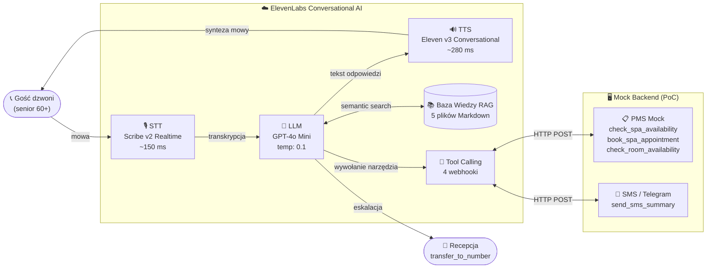
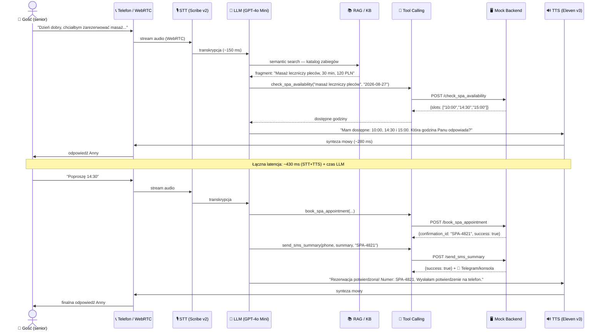
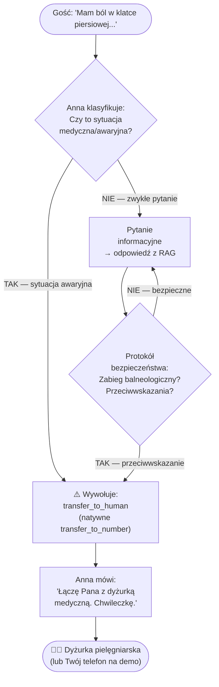
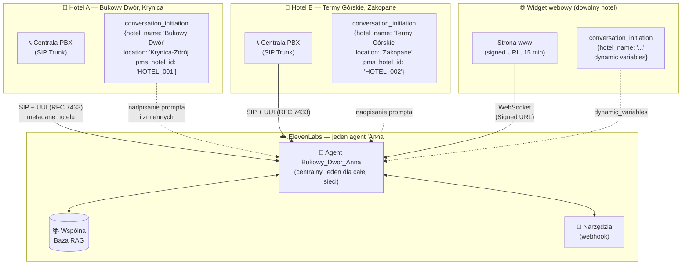
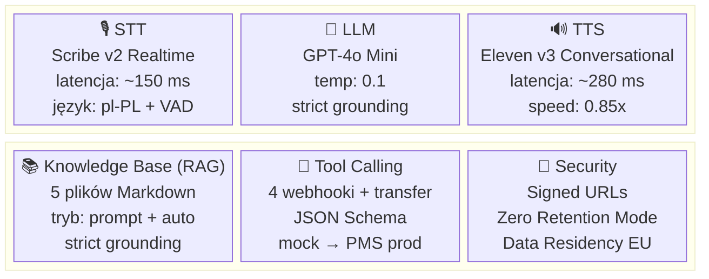

# Diagramy Architektury — Wirtualny Recepcjonista AI „Bukowy Dwór"

Gotowe diagramy Mermaid do wklejenia na slajdy lub do Excalidraw.

---

## DIAGRAM 1 — Główny przepływ konwersacyjny (High-level, na slajd tytułowy)

---

## DIAGRAM 2 — Szczegółowy przepływ danych (System Design, na slajd techniczny)

---

## DIAGRAM 3 — Scenariusz eskalacji (Human Handoff)

---

## DIAGRAM 4 — Architektura multi-hotel (skalowanie, slajd Enterprise)

---

## DIAGRAM 5 — Stos technologiczny (do slajdu „Stack")

